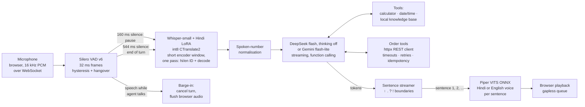

# Hinglish voice agent

Ask a question out loud in Hindi, English or a mix of both, and hear a spoken answer. Everything except the language model runs on a laptop CPU, and every latency figure below is measured end to end on fixed recordings, not estimated.

## The problem, in plain language

Talking to a computer feels natural only when it answers quickly and understands the way people actually speak. For hundreds of millions of people in India that means Hinglish: *"मेरा बिल चार हज़ार रुपये है, इसे पाँच दोस्तों में split करो"*. Most voice assistants handle one language at a time, run on large GPU servers, and quote latency numbers that leave out parts of the round trip.

This project is a complete voice loop that runs on an ordinary laptop:

1. It **listens** and works out by itself when you have finished speaking.
2. It **transcribes** Hindi, English or code-mixed speech with a small Whisper model that I fine-tuned for Hindi.
3. It **thinks** with a small LLM that can use tools: a calculator, the clock and a local knowledge base.
4. It **speaks** the answer in a Hindi or English voice, starting with the first sentence while the rest is still being written.
5. You can **interrupt** it by talking over it, as you would interrupt a person.

It also reports how long each of those steps took, on a fixed set of test recordings, on the CPU named below.

## How it works



One turn, step by step:

1. **Voice activity detection.** The browser sends 16 kHz audio in small chunks. Silero VAD scores each 32 ms frame. Speech starts after 192 ms above a 0.5 threshold, and the turn ends after 544 ms below 0.35. 320 ms of audio from before the start is kept so the first syllable is not clipped.
2. **Speculative transcription.** After the first 160 ms of silence the VAD emits a *pause* event with the audio cut exactly as the end of turn would cut it, and decoding starts right away. If the user stays quiet, the turn reuses that transcript. If they keep talking, it is thrown away.
3. **Speech-to-text.** The fine-tuned Whisper-small ([Dratinia/whisper-small-hindi-lora](https://huggingface.co/Dratinia/whisper-small-hindi-lora), from my [hindi-voice-asr](https://github.com/Abhigyan1805/hindi-voice-asr) project), merged and converted to int8 CTranslate2 (250 MB). The encoder runs **once**, on the utterance plus 5 s of padding rather than Whisper's full 30 s window (utterances of 12 s or more, and short decodes that loop or run too long, use the full window). Whisper's language-ID head picks Hindi or English from that encoder output, and the decoder reuses it. Runs of spoken digits in the transcript are then rewritten as digit strings.
4. **LLM with tools.** The transcript and a short rolling history go to the LLM over a streaming endpoint: DeepSeek flash with thinking off when `DEEPSEEK_API_KEY` is set, otherwise Gemini flash-lite (free tier). The model can call `calculator`, `get_datetime` or `search_knowledge`, and, when an order service is configured, the three order tools. Tool results go back in the same turn, and the reply streams token by token. The system prompt asks for one to three short spoken sentences in the user's language, Devanagari for Hindi, with no markdown.
5. **Sentence streaming.** Tokens are cut into sentences at `। ॥ . ! ?` and newlines. The cutter knows about decimals and abbreviations, merges very short pieces after the first, and splits run-on sentences at commas. Each sentence goes to TTS as soon as it is complete, so the first one plays while the LLM is still writing the rest.
6. **Text-to-speech.** Piper (VITS exported to ONNX, 63 MB per voice) synthesises each sentence with a Hindi voice (`hi_IN-priyamvada-medium`) or an English voice (`en_US-lessac-medium`), chosen by script. espeak-ng's Hindi phonemiser reads digits in Hindi and pronounces Latin-script English words in English, so code-mixed sentences stay on the Hindi voice.
7. **Barge-in.** The VAD keeps running while the agent talks. Speech start during a reply cancels the LLM stream and the TTS loop at the next token or sentence, and tells the browser to drop its queued audio. The cut-off reply is kept in history, marked `[interrupted]`.

## Results at a glance

The block below is generated from the JSON files in `results/` by `python scripts/report.py --readme`, and a unit test fails if it is out of date.

<!-- results:begin -->
<!-- generated by scripts/report.py --readme; do not edit by hand -->

### Latency: what each change bought

End of speech to first reply audio, measured by wall clock with the audio fed in real time (`scripts/bench.py`, 20 spoken questions + 8 FLEURS sentences, 2 rounds = 56 turns). One run per row on a shared laptop CPU; the LLM is a live API, so gaps under about 0.5 s are within run-to-run noise.

| Configuration | Turns without error | E2E p50 | E2E p95 | End-of-turn wait p50 | STT left p50 | LLM first sentence p50 | TTS first p50 | Tool used as expected | Knowledge-base tool |
|---|---:|---:|---:|---:|---:|---:|---:|---:|---:|
| Gemini 3.5 flash-lite (free tier), original code | 56/56 | **7.43 s** | 17.11 s | 0.55 s | 2.24 s | 3.20 s | 0.28 s | 22/22 | 8/8 |
| DeepSeek flash, thinking off, original prompt | 56/56 | **4.17 s** | 9.44 s | 0.55 s | 1.97 s | 1.18 s | 0.26 s | 16/22 | 3/8 |
| + tool section in the system prompt | 56/56 | **4.05 s** | 8.63 s | 0.55 s | 1.89 s | 1.25 s | 0.24 s | 22/22 | 8/8 |
| + short STT window (end-of-turn sweep kept 544 ms) | 54/56 | **2.67 s** | 6.38 s | 0.55 s | 0.51 s | 1.19 s | 0.24 s | 22/22 | 8/8 |
| Final code, shipped defaults (digit fix on, order tools off) | 56/56 | **2.65 s** | 6.24 s | 0.55 s | 0.51 s | 1.08 s | 0.24 s | 22/22 | 8/8 |

Latency percentiles are over the turns without error. Errors are LLM requests that failed or hit the voice timeout (8 s without data); the agent speaks a short apology on those turns. + short STT window (end-of-turn sweep kept 544 ms): ReadTimeout: The read operation timed out, ConnectTimeout: timed out.

Last row: STT window utterance + 5 s below 12 s (2 of 56 turns fell back to 30 s), VAD end-of-turn 544 ms, speculative STT at 160 ms (44 speculative decodes wasted). LLM tokens for the run: 82499 prompt, 4513 completion.

### Final run on shipped defaults (order tools off)

CPU: 11th Gen Intel(R) Core(TM) i5-11300H @ 3.10GHz (6 logical CPUs visible in WSL2), STT on 4 threads. LLM: None (0 turns), live calls, cache off. 56 turns (2 rounds over 28 prompts), 56 without errors. Audio fed in real time; speculative STT on. Machine load average during turns: median 1.6, p95 2.5 (other jobs share this machine). Peak RSS of the whole process: 1067 MB.

| Stage | p50 | p95 | mean |
|---|---:|---:|---:|
| VAD, CPU per 32 ms frame | 0.603 ms | 0.659 ms | 0.601 ms |
| End-of-turn wait (VAD hangover) | 0.55 s | 0.55 s | 0.54 s |
| Speech-to-text, left on the critical path | 0.51 s | 4.55 s | 1.12 s |
| Speech-to-text, full decode | 0.89 s | 4.93 s | 1.50 s |
| LLM first token (incl. tool round trips) | 0.82 s | 1.70 s | 0.96 s |
| LLM first complete sentence | 1.08 s | 1.98 s | 1.21 s |
| TTS first sentence | 0.24 s | 0.49 s | 0.26 s |
| **End of speech → first reply audio** | **2.65 s** | **6.24 s** | 3.14 s |

By group (end of speech → first reply audio):

| Turns | n | p50 | p95 |
|---|---:|---:|---:|
| All | 56 | 2.65 s | 6.24 s |
| no tool call | 34 | 2.36 s | 6.52 s |
| with tool call | 22 | 2.90 s | 5.38 s |
| synthetic prompts | 40 | 2.42 s | 4.30 s |
| FLEURS real speech | 16 | 3.91 s | 6.68 s |
| Hindi | 34 | 3.02 s | 6.52 s |
| Hinglish | 12 | 2.54 s | 5.54 s |
| English | 10 | 1.89 s | 2.90 s |

LLM first token, no tool call: p50 0.65 s / p95 0.90 s; with a tool call (two LLM requests): p50 1.42 s / p95 2.04 s.

Speculative STT was used on 56/56 turns and took a median 0.383 s (min 0.365, max 0.386) of decode time off the critical path, measured within the same turn as full decode time minus the STT time left after the end of the turn. That is the 384 ms between the VAD's pause (160 ms) and end-of-turn (544 ms) events.

Language ID (Hindi vs English, from the single encoder pass): English prompts 10/10, Hindi and Hinglish prompts 46/46. Expected tool used: calculator 8/8, date/time 6/6, knowledge base 8/8.

### Tool routing, text only

`scripts/eval_tools.py`: each input goes straight to the LLM (deepseek-flash, thinking off) as the first turn of a call, 3 repetitions, cache off. Inputs: 28 benchmark transcripts as the recogniser heard them, the same 28 as written, and 21 more utterances (tool and no-tool, 3 deliberately garbled). v1 is the original one-sentence tool rule; v2 is the current tool section.

| Prompt | Tool used when needed | Calculator | Date/time | Knowledge base | Unnecessary tool calls | First token p50, no tool / tool |
|---|---:|---:|---:|---:|---:|---:|
| v1 | 83/102 | 34/36 | 26/27 | 23/39 | 0/129 | 0.66 s / 1.47 s |
| v2 | 100/102 | 36/36 | 25/27 | 39/39 | 0/129 | 0.67 s / 1.49 s |

v2 on the spoken-benchmark transcripts alone: tool used when needed 31/33, unnecessary tool calls 0/51. Tokens for the whole evaluation: 618139 prompt, 36545 completion.

### Speech recognition: FLEURS hi_in test, clips 150-249 in file-name order

100 clips, 19.54 min. `30s` encodes Whisper's full 30 s window; `short` encodes the utterance + 5.0 s and falls back to 30 s when the decode loops or runs too long. Generation stops at 222 tokens, which long Hindi sentences can reach.

| Decoding | WER | CER | Latency p50 | Latency p95 | Fallbacks to 30 s | Hit token limit | Detected as English |
|---|---:|---:|---:|---:|---:|---:|---:|
| 30s/forced-hi | 27.38 % | 11.82 % | 3.31 s | 4.79 s | 0 | 6 | 0 |
| 30s/auto | 27.38 % | 11.82 % | 3.43 s | 4.89 s | 0 | 6 | 0 |
| short/auto | 27.61 % | 11.76 % | 2.48 s | 5.29 s | 4 | 6 | 0 |

### End-of-turn detection

`scripts/eval_endpoint.py`, VAD only: 20 benchmark prompts (Piper) + FLEURS hi_in test clips 150-249, each padded 0.5 s before / 1.5 s after. A premature cut means the VAD ended the turn at a pause before the speaker had finished. Rule: smallest end_silence_ms with 0 premature cuts on the questions and a FLEURS premature-cut rate at most 2.0 percentage points above the 544 ms baseline. Chosen: **544 ms**.

| Silence before end of turn | Questions cut early | FLEURS sentences cut early | Wasted speculative decodes per FLEURS clip |
|---:|---:|---:|---:|
| 256 ms | 2/20 | 53/100 (53 %) | 0.88 |
| 320 ms | 1/20 | 42/100 (42 %) | 1.33 |
| 384 ms | 0/20 | 34/100 (34 %) | 1.58 |
| 448 ms | 0/20 | 25/100 (25 %) | 1.78 |
| 544 ms | 0/20 | 15/100 (15 %) | 1.93 |
| 704 ms | 0/20 | 11/100 (11 %) | 2.02 |

### REST tool under injected faults

`scripts/eval_rest_tool.py`: the order tools' client against the local stand-in order service (src/voice_agent/demo_service.py) over HTTP on 127.0.0.1, no LLM. Client: connect timeout 1 s, read timeout 2.5 s, 5 s budget per tool call, up to 2 retries with jittered back-off. 30 calls per mode. **330/330** calls ended in the expected outcome (the order data, or an error the agent can speak about instead of inventing an answer); 330/330 stayed within the budget.

| Fault | Expected outcome | Correct | Attempts (mean) | Seconds p50 | Seconds max |
|---|---|---:|---:|---:|---:|
| none | ok | 30/30 | 1.0 | 0.00 | 0.00 |
| latency 300 ms | ok | 30/30 | 1.0 | 0.30 | 0.30 |
| one 503, then success | ok | 30/30 | 2.0 | 0.20 | 0.30 |
| two 503s, then success | ok | 30/30 | 3.0 | 0.64 | 0.85 |
| three 503s (more than the retries) | unavailable | 30/30 | 3.0 | 0.61 | 0.89 |
| 429 with Retry-After 1 s | ok | 30/30 | 2.0 | 1.00 | 1.01 |
| malformed body once | ok | 30/30 | 2.0 | 0.20 | 0.30 |
| hang 4 s (longer than the read timeout) | timeout | 30/30 | 2.0 | 5.00 | 5.00 |
| unknown order id | not_found | 30/30 | 1.0 | 0.00 | 0.00 |
| reschedule, one 503 then success | ok | 30/30 | 2.0 | 0.24 | 0.30 |
| reschedule a delivered order | rejected | 30/30 | 1.0 | 0.00 | 0.00 |

### Call quality: scripted multi-turn calls

`scripts/eval_calls.py`: 12 scripted calls (29 caller turns) with the order tools on, each run 3 times. Spoken track: the callers' recorded audio (synthetic Piper voices) through VAD, STT, the LLM (deepseek-flash, thinking off) with tools, and TTS. Oracle track: the same calls with the reference text given to the LLM directly. A call passes when every turn passes every check and the order service ends in the expected state. Each failed spoken call is attributed to the stage that caused its first failing turn (rules below the block).

| Prompt | Calls passed, spoken | Calls passed, oracle text | Spoken, tuning calls | Spoken, held-out calls | Turns passed, spoken | Tool calls correct, spoken / oracle | Failures by stage (spoken) |
|---|---:|---:|---:|---:|---:|---:|---|
| v1 | **5/36** | 25/36 | 5/24 | 0/12 | 42/87 | 28/48 / 47/48 | llm 9, stt 21, tts 1 |
| v2 | **8/36** | 31/36 | 6/24 | 2/12 | 47/87 | 27/48 / 48/48 | llm 2, stt 26 |
| v3 | **10/36** | 32/36 | 6/24 | 4/12 | 50/87 | 28/48 / 47/48 | llm 3, stt 23 |

Latest prompt (v3): per-turn WER median 25.0 % (mean 28.1 %, 24 of 87 turns error-free; digits counted one per token whether spoken as words or written as numbers). Order ids and phone numbers recognised exactly: 18/36 turns. LLM tokens for the run: 528733 prompt, 13976 completion.

| Call | Language | Held out | Passed, spoken | Passed, oracle |
|---|---|---|---:|---:|
| `c01-status-hi` | hi |  | 3/3 | 3/3 |
| `c02-status-en` | en |  | 3/3 | 3/3 |
| `c03-unknown-id` | hi | yes | 0/3 | 3/3 |
| `c04-reschedule-hx` | hinglish |  | 0/3 | 2/3 |
| `c05-delivered-en` | en |  | 0/3 | 3/3 |
| `c06-caller-declines` | hi | yes | 0/3 | 3/3 |
| `c07-retries-en` | en |  | 0/3 | 3/3 |
| `c08-service-hangs` | hi |  | 0/3 | 3/3 |
| `c09-phone-lookup` | en | yes | 1/3 | 0/3 |
| `c10-discount-maths` | hinglish |  | 0/3 | 3/3 |
| `c11-helpline-midcall` | hi |  | 0/3 | 3/3 |
| `c12-scope-and-switch` | hi+en | yes | 3/3 | 3/3 |

Worked failure examples (first failing turn of a call, one per stage, from the latest run):

- **stt** (`c03-unknown-id`, turn 2): caller said "माफ़ कीजिए, सही नंबर है सात दो नौ शून्य पाँच।"; recogniser heard "माफ़ किजे! सही नंबर है साथ दो नौश्य उन्य पाथ्स!"; tools: get_order_status(order_id=72959) -> not_found; reply "माफ़ कीजिए, 72959 भी सिस्टम में नहीं मिला। क्या आप अपना 10 अंकों का फ़ोन नंबर बता सकते हैं, मैं उससे ऑर्डर ढू…". Failed check: tools, reply_any.
- **llm** (`c04-reschedule-hx`, turn 2): caller said "उसे बीस नवंबर को कर दो।"; recogniser heard "उसे 20 नवंबर को कर दो।"; tools: get_order_status(order_id=48813) -> not_found; reply "48813 नंबर से अभी भी कोई ऑर्डर नहीं मिल रहा, इसलिए मैं तारीख़ नहीं बदल सकता। आप अपना 10 अंकों का फ़ोन नंबर बत…". Failed check: reply_any.

### Misheard digits: before and after the fix

Same 12 calls and 3 repetitions, with a reactive simulated caller: when the agent reads back a wrong order id or phone number, or asks for it again, the caller repeats it slowly digit by digit (at most twice), and confirms a correct read-back. A turn passes with at most one repeat. "Before" is the v3 prompt with no number handling (`VOICE_AGENT_DIGIT_FIX=0`); "after" adds spoken-number normalisation of the transcript, a digit hint to the recogniser on the turn after the agent asks for a number, and a read-back-and-confirm rule in the prompt. Exact id on first try: the 5-digit id or 10-digit phone number appears as one digit string in what the LLM received from the caller's first attempt.

| Run | Calls passed, spoken | Held-out calls, spoken | Calls passed, oracle | Exact id on first try | Right id reached the order tool | Id turns with 0 / 1 / 2 repeats | Failures by stage |
|---|---:|---:|---:|---:|---:|---:|---|
| before, clean | **13/36** | 4/12 | 32/36 | 15/39 | 21/39 | 28 / 8 / 3 | llm 4, stt 16, tts 3 |
| after, clean | **19/36** | 5/12 | 31/36 | 15/39 | 25/39 | 24 / 13 / 2 | llm 2, stt 13, tts 2 |
| before, telephone | **14/36** | 4/12 | 32/36 | 12/39 | 24/39 | 26 / 9 / 4 | llm 2, stt 19, tts 1 |
| after, telephone | **16/36** | 3/12 | 31/36 | 15/39 | 25/39 | 28 / 7 / 4 | llm 3, stt 15, tts 2 |

### Phone audio: simulated telephone channel

`scripts/eval_wer.py --conditions`: the same 100 FLEURS clips passed through a simulated channel (`src/voice_agent/degrade.py`): `tel` = 300-3400 Hz band-pass, 8 kHz, G.711 mu-law, back to 16 kHz; `opus8` = Opus at 8 kbit/s narrowband after that (no GSM/AMR encoder is available here); `babbleN` / `whiteN` = babble from 6 other FLEURS speakers or white noise at N dB SNR, added before the channel; `loss5` = 5 % of 20 ms frames dropped without concealment. Agent decoding (short window, language ID).

| Condition | WER | CER | Latency p50 | Fallbacks to 30 s | Clips with no speech found / split by the VAD | Detected as English |
|---|---:|---:|---:|---:|---:|---:|
| clean | 27.61 % | 11.76 % | 2.71 s | 4 | 0 / 15 | 0 |
| tel | 32.82 % | 14.91 % | 2.69 s | 1 | 1 / 21 | 0 |
| tel+opus8 | 38.66 % | 18.43 % | 2.55 s | 2 | 1 / 28 | 1 |
| tel+babble15 | 40.47 % | 19.72 % | 2.74 s | 2 | 1 / 19 | 0 |
| tel+babble5 | 74.79 % | 48.39 % | 2.57 s | 3 | 1 / 7 | 1 |
| tel+white10 | 54.16 % | 28.11 % | 2.66 s | 1 | 1 / 21 | 0 |
| tel+loss5 | 34.71 % | 15.76 % | 2.88 s | 1 | 0 / 29 | 0 |

Call suite on the same channel (spoken track; the oracle-text track does not depend on audio and is reused from the clean run):

| Audio | Calls passed, spoken | Turns passed | Tool calls correct | Per-turn WER median | Order/phone digits heard | Failures by stage |
|---|---:|---:|---:|---:|---:|---|
| clean | **10/36** | 50/87 | 28/48 | 25.0 % | 18/36 | llm 3, stt 23 |
| tel | **13/36** | 56/87 | 33/48 | 25.0 % | 18/36 | llm 2, stt 20, tts 1 |
| tel-babble15 | **9/36** | 47/87 | 29/48 | 40.0 % | 12/36 | llm 3, stt 23, vad 1 |

### LLM provider comparison (original code, original prompt)

Same 56 turns, same recorded audio, same code and machine, one run per provider (back to back, so the free-tier service and the machine load differ between runs; treat gaps under about 0.5 s as noise).

| LLM | Turns without error | LLM first token p50 / p95 | First sentence p50 / p95 | End of speech → first audio p50 / p95 | Tokens per turn (prompt / completion, mean) | Tool used as expected |
|---|---:|---:|---:|---:|---:|---:|
| Gemini 3.5 flash-lite (free tier), original code | 56/56 | 2.99 s / 6.02 s | 3.20 s / 6.46 s | 7.43 s / 17.11 s | not recorded | 22/22 |
| DeepSeek flash, provider default (thinking on) | 51/56 | 2.11 s / 3.22 s | 2.34 s / 3.48 s | 5.90 s / 11.65 s | 1271 / 218 | 21/22 |
| DeepSeek flash, thinking off | 56/56 | 0.88 s / 1.97 s | 1.18 s / 2.10 s | 4.17 s / 9.44 s | 1095 / 78 | 16/22 |

### Text-to-speech

| Voice | RTF | Mean synthesis per sentence | Round-trip WER | Round-trip CER |
|---|---:|---:|---:|---:|
| `hi_IN-priyamvada-medium` | 0.049 | 0.18 s | 30.8 % | 16.7 % |
| `hi_IN-pratham-medium` | 0.052 | 0.16 s | 24.2 % | 15.0 % |
| `hi_IN-rohan-medium` | 0.050 | 0.18 s | 28.6 % | 16.5 % |
| `en_US-lessac-medium` | 0.061 | 0.15 s | 27.9 % | 22.5 % |

Round trip: synthesise fixed sentences, transcribe them with the agent's own recogniser, score against the input text. It is a proxy for intelligibility that inherits the recogniser's errors.

### LLM spend

DeepSeek tokens recorded across 13 committed result files: 5,954,921 prompt and 184,053 completion (the largest share is the call suite, which replays whole conversations every turn). Per-file totals are in each file.

<!-- results:end -->

All tables, with more detail (per-stage latency of the final run, run-to-run variation, superseded runs), are in [results/RESULTS.md](results/RESULTS.md); per-turn rows are in the JSON files next to it.

## Reading the results

- **Where the latency went.** On the original code the free-tier LLM was the largest and least predictable stage. Switching to DeepSeek with thinking off removed most of that, and left speech recognition as the largest stage. Encoding only the utterance plus a few seconds of padding, instead of Whisper's fixed 30 s window, took most of the recognition time off short questions at nearly the same WER; long utterances still use the full window. The end-of-turn sweep found no shorter silence threshold that kept read sentences from being cut, so the 544 ms setting stayed.
- **Tool use with thinking off.** The original one-sentence tool rule let the model answer helpline and "about you" questions from memory. A tool section that names when each tool must be called, and when no tool is needed, restored knowledge-base use without adding unnecessary calls, at the same first-token time.
- **Two LLM requests that timed out.** The new 8 s voice timeout turns a stalled request into a spoken apology instead of a long silence; the latency table counts those turns as errors rather than hiding them.
- **Calls fail mostly on digits.** The oracle-text track passes far more calls than the spoken one, and the attribution puts almost all spoken failures on speech recognition, nearly always an order id or phone number misheard. The digit fix (below) recovers some of those calls through read-back and repetition, not through better recognition.
- **Phone audio costs WER, most of all with noise.** Band-limiting and mu-law alone cost a few WER points; a low-bitrate codec and babble noise cost more, and loud babble makes the recogniser unusable. The call-suite rows under the same conditions move less than their run-to-run noise.
- **Run-to-run noise.** One run per configuration, on a shared laptop CPU, with a live LLM API. Small gaps between rows are noise.

## Call-quality suite

`evals/calls/calls.json` holds 12 scripted calls to the order desk, in Hindi, English and Hinglish: order status, an unknown order id, a reschedule with read-back and confirmation, a reschedule the service refuses (already delivered), a caller who says no at the confirmation, a service that fails twice before answering, a service that hangs, a lookup by phone number, a discount calculation mid-call, a helpline question mid-call, and an out-of-scope request followed by a switch to English. Each caller turn is recorded once with a Piper voice (`scripts/make_call_audio.py`), so the callers are synthetic. Every turn is checked for the tool calls it must (or must not) make, with order ids and phone numbers compared as digits; for facts the reply must contain (a status word, the delivery day, `1930`, `1020`); for things it must not say (an invented status while the service is down); and for the reply language. Call-level checks look at the order service afterwards (was the date changed, or left alone) and for facts that may come in any turn.

`scripts/eval_calls.py` runs each call twice: spoken (recorded audio through VAD, speech recognition, LLM with tools, TTS) and as oracle text (the reference text straight to the LLM). Comparing the two is what lets it say which stage broke a call. The first failing turn of a spoken call is attributed by these rules, in order; later failures in the same call are marked as cascade:

1. **tool**: the turn's tool calls were right, but the service or client failed in a way the script did not plan for (timeout or unavailable with no injected fault), or the client broke its time budget.
2. **vad**: the VAD found no speech in the turn, or split it into several turns.
3. **tts** (suspect): the reply text passed every check, but a required number or date was lost when the spoken reply was transcribed back by the agent's own recogniser. Recogniser errors are in that loop too, so this is a suspicion, not proof.
4. **stt**: the turn failed spoken but passed as oracle text.
5. **llm**: the turn failed as oracle text too.

A call whose turns all pass but whose final state is wrong counts as **llm** if the oracle call also ended wrong, else **stt**. The rules are heuristics; every turn's transcript, reply, tool calls with HTTP attempts, checks and stage times are in `results/calls-clean-v*.json`.

**Prompt tuning, with held-out calls.** Four calls (`c03`, `c06`, `c09`, `c12`) were held out: prompt changes were made by reading failures of the other eight only, at most twice, and every version's run is kept (`results/calls-clean-v1.json` to `-v3.json`, prompt diffs in `results/prompt-v1-to-v2.diff` and `results/prompt-v2-to-v3.diff`). v2 made the agent look the order up before a reschedule, forbade calling `reschedule_delivery` in the same turn as the request, required a spoken reply after every tool result, and asked for the reply in the language of the caller's latest turn. v3 added that a date given with the request is not a confirmation, and that a short English "yes" or "thank you" is English. The language rule came from a tuning call (`c05`), though it also bears on the held-out language-switch call `c12`.

Check fixes after the first run, applied to every version by re-scoring the stored results (`eval_calls.py --rescore`): `c05` required the word "delivered" in the second turn, but a correct agent says so in the first turn as soon as it looks the order up; that check moved to call level. No other script or check changed after the first run. Per-turn WER writes digits one per token on both sides, because the scripts spell order ids as words ("चार आठ दो") while the recogniser writes digits.

## Misheard digits

The call suite showed that most spoken calls fail on one thing: order ids and phone numbers read digit by digit come out of the recogniser wrong ("four four seven two nine" as `444729`, a dropped final "शून्य", "नौ शून्य" as `9-10`). The model was not fine-tuned for this; three cheaper measures sit around it instead:

1. **Spoken-number normalisation** (`src/voice_agent/numbers.py`). Runs of digit words in English or Hindi, "double five" / "डबल पाँच", Devanagari numerals, and digit groups split by spaces, commas or hyphens are rewritten as one digit string before the LLM and the tools see them. Ordinary numbers and the everyday uses of "एक", "दो" or "one" are left alone. The raw transcript is still what WER is scored on.
2. **A digit hint for the recogniser**, only on the turn after the agent asked for a number: a short previous-context prompt with spaced digits is passed to Whisper's decoder. Every other turn decodes exactly as before.
3. **Read-back and confirm.** The prompt tells the agent to read any id or phone number back digit by digit and ask whether it is right before calling a tool, to read back a corrected number the same way, and after two failed attempts to offer the phone-number lookup or a call back.

To score this, the simulated caller in the call suite became reactive: it confirms a correct read-back and repeats the number slowly when the agent reads back a wrong one or asks again, at most twice. One corrected repeat still counts as a pass; two do not. The before and after runs use the same reactive caller, so the comparison isolates the fix. `VOICE_AGENT_DIGIT_FIX=0` turns all three measures off.

What the before/after table in the results block shows: more spoken calls pass with the fix, on clean and on telephone audio, but the gain comes from read-back and the caller's repeat getting the right id to the order tool, not from the recogniser hearing the id right the first time, which barely changed. Normalisation rarely matters here because the recogniser already writes digits; its errors are wrong or missing digits, which no rewriting can recover. The held-out calls did not improve. The prompt rule was written from the failures of the eight tuning calls, and a few calls of difference out of 36 is within run-to-run noise.

## Phone audio

A phone call reaches an agent as 8 kHz narrowband audio, compressed and often noisy. `src/voice_agent/degrade.py` simulates that channel on recorded audio, deterministically: a 300-3400 Hz band-pass (windowed-sinc FIR in numpy), anti-aliased decimation to 8 kHz, G.711 mu-law encoding, and back to 16 kHz for the recogniser; optionally Opus at 8 kbit/s through PyAV as a low-bitrate codec (this PyAV build has no GSM or AMR encoder), babble noise mixed from six FLEURS speakers outside every evaluation slice or white noise at a set SNR (measured over the frames the VAD scores as speech, and added before the channel, at the caller's side), and dropped 20 ms frames without concealment. The same 100 FLEURS clips and the same 12 scripted calls are then scored under each condition (tables in the results block).

Reading the call-suite rows: the telephone-channel run passed more calls than the clean run. That is not a sign that phone audio helps; with 36 calls, a live LLM and recogniser errors that move from run to run, a gap of a few calls is noise. The FLEURS WER rows, on 100 clips with no LLM in the loop, are the steadier measure of what the channel costs.

What this does not show: the channel is simulated, the noise is synthetic, and the speech underneath is clean read speech or synthetic callers. `voice-agent serve` has no telephony front end; these numbers come from degrading recordings, not from real calls.

## Design decisions

- **Measure the whole round trip, in real time.** The benchmark feeds each recording to the VAD at microphone pace, in 32 ms frames, and times by wall clock from the moment the last speech frame arrives to the moment the first reply audio is ready. That includes the end-of-turn wait, which many published numbers leave out.
- **One encoder pass for language ID.** Forcing `language="hi"` turned English questions into Devanagari gibberish ("व्या पर च्कर्व रूट 144…" for "What is the square root of 144…"). faster-whisper's auto-detection fixes that but runs the encoder a second time. Reading the language-ID head from the encoder output that the decoder already uses costs almost nothing, and the WER table shows no Hindi clip detected as English.
- **Speculative STT** moves part of the decode into the end-of-turn wait; the saving is measured inside each turn (see RESULTS.md).
- **A short encoder window with a guard.** Whisper always encodes 30 s, which on this CPU dominated the cost of a two-second question. Encoding the utterance plus padding is much cheaper, but with too little trailing padding the decoder can miss its end token and loop; such decodes are detected (repeated n-grams, more tokens than the audio can hold, the generation limit) and redone with the full window. The WER table scores both windows on the same clips.
- **DeepSeek with thinking off as the default LLM, tool use fixed in the prompt.** Reasoning tokens add latency and, under a short output cap, sometimes leave no reply at all. With thinking off the model skipped tools it should have called, which a stricter tool section fixed (tool-routing table).
- **A Gemini model fallback.** During this work `gemini-3.1-flash-lite` returned HTTP 503 ("high demand") for every request for a while. The client now tries the configured model with two retries, falls back to the next free model, and stays there for five minutes. Each turn records which model answered.
- **An order desk over a real REST client.** With `VOICE_AGENT_ORDERS_URL` set, the agent gets three more tools (`get_order_status`, `find_orders_by_phone`, `reschedule_delivery`) that call an order service over HTTP with `httpx`: connect and read timeouts, a total time budget per tool call, bounded retries with jittered back-off on connect errors, timeouts, 502/503/504, 429 (`Retry-After` honoured) and malformed bodies, and an `Idempotency-Key` on the reschedule write so a retried request cannot apply twice. Failures come back to the LLM as `not_found`, `timeout`, `unavailable` or `rejected`, and the system prompt tells it to say the system is slow rather than invent a status, to read the order id back digit by digit and to wait for a yes before any change. The service in this repo (`voice-agent demo-service`) is a local stand-in with seeded data and fault injection, not a real business system; the client would point at any service with the same contract. While a network tool runs, the agent says "one moment" so the caller is not left in silence.
- **Tool errors are data, not exceptions.** The calculator parses with `ast`, never `eval`, accepts `×`, `÷`, `%`, `18% of 1250` and Devanagari digits, and returns `{"error": ...}` so the LLM can recover. An LLM failure is spoken as a short apology instead of silence.
- **Bounded memory.** One STT model, two small TTS voices and a 2 MB VAD, loaded once. The evaluation reads FLEURS through a child process because decoding the single-row-group parquet takes far more memory than the agent itself.

## Limitations and honest notes

- **CPU only, on a shared machine.** All numbers come from one laptop CPU in WSL2, with other jobs running at the same time (the load average is recorded per turn). A quiet machine or a desktop CPU would be faster, and a GPU much faster.
- **STT is still a large stage for long utterances.** The short window helps short questions; long sentences use the full 30 s window and Hindi needs about one token per character. Streaming partial transcripts are not used; the turn is transcribed once it ends, or speculatively at the pause. Generation stops at 222 tokens, which very long Hindi sentences can reach (counted in the WER table).
- **Small, partly synthetic test set.** The 20 question prompts are synthetic: they are spoken by Piper voices that differ from the reply voices, not by people. The 8 real-speech prompts are FLEURS read sentences, not questions. They show the cost of long real utterances, not conversational behaviour. WER uses 100 FLEURS clips, about 20 minutes of clean read speech. Conversational, noisy or strongly code-mixed speech will do worse.
- **Recognition errors reach the answer.** Example from the benchmark: *"तेईस गुणा सैंतालीस"* (23 × 47) was heard as *"टीज़ गुणा 47"*, so the agent confidently computed 30 × 47. In a live check, "online fraud" in a Hinglish question came out as "अनलैंड फ़ॉथ", and the agent gave the general emergency number 112 instead of the cyber-fraud helpline 1930. The fine-tuned model also writes many English words in Devanagari, sometimes misspelt ("split" became "स्पृत"), because its FLEURS training data does the same.
- **A live LLM API.** The default is DeepSeek, a paid API; Gemini's free tier is the alternative and varies by seconds between requests and with demand. Each configuration was measured in one run, so LLM time-to-first-token is the noisiest number here. A turn that calls a tool pays for two LLM round trips. Token counts for every run are in the results files.
- **Synthetic callers, a simulated phone line, a stand-in backend.** The call suite's callers are Piper voices reading scripts, 12 calls in all; the phone conditions are simulated on recordings; the order service is a local stand-in with seeded data. None of it is real usage or real traffic.
- **Barge-in needs headphones.** Browser echo cancellation does not reliably remove Web Audio playback, so on laptop speakers the agent can hear itself and stop. The UI has an "allow interrupting" switch that makes it half-duplex. Barge-in is covered by unit tests (WebSocket protocol, cancellation, history) and by `scripts/smoke_ws.py`, which streams a recorded question to the running server in real time and then talks over the reply. I could not drive it from a real browser with a real microphone in the environment where this was built, so the browser audio path (worklet capture, playback queue, echo) is the least tested part.
- **Voice licences are non-commercial.** The Hindi Piper voices are trained on CC BY-NC-SA data, and `rohan` on IIT Madras IndicTTS data under its own licence. That is fine for a portfolio demo, not for a product. The pipeline does not depend on a particular voice: point `VOICE_AGENT_TTS_HI` at any Piper voice.
- **Not deployed.** This is a local demo. No users, uptime or production traffic are claimed.

## How to run

Requirements: tested with Python 3.12 (the wheels for `ctranslate2` and `onnxruntime` lag behind new Python releases, so avoid 3.14), about 1.5 GB of free RAM and 600 MB of disk for models.

```bash
python3.12 -m venv .venv && . .venv/bin/activate
pip install -e ".[eval,dev]"

# 1. Speech model: whisper-small + Hindi LoRA, merged, int8 CTranslate2 (needs torch/transformers/peft once, ~2 GB RAM)
pip install torch transformers peft && python scripts/build_stt_model.py
#    or copy an existing build from hindi-voice-asr (python -m hindi_asr.quant convert) to models/whisper-small-hindi-ct2-int8/
#    (every number here used the build from that command; build_stt_model.py follows the same recipe but was not re-run here)

# 2. Piper voices (about 63 MB each)
mkdir -p models/piper && cd models/piper
B=https://huggingface.co/rhasspy/piper-voices/resolve/main
for v in hi/hi_IN/priyamvada/medium/hi_IN-priyamvada-medium en/en_US/lessac/medium/en_US-lessac-medium; do
  curl -LO $B/$v.onnx && curl -LO $B/$v.onnx.json; done
cd ../..

# 3. LLM key: DEEPSEEK_API_KEY (default, thinking off) or a free GOOGLE_API_KEY from Google AI Studio.
#    Without one the agent runs an offline rule-based fallback.
echo "DEEPSEEK_API_KEY=..." > .env        # or point VOICE_AGENT_ENV_FILE at a file elsewhere
```

Talk to it:

```bash
voice-agent serve                         # http://127.0.0.1:8000: live mic, streaming replies, barge-in, typed input
voice-agent ask prompts/audio/hx-calc-3.wav --out reply.wav   # one recorded question, prints per-stage timings
voice-agent chat                          # type questions, replies saved as wav (add --play to play them via aplay)
```

Measure it:

```bash
pytest                                    # unit tests: VAD, sentence streaming, tools, LLM tool loops, pipeline, WebSocket
python scripts/eval_wer.py                # WER/CER on FLEURS hi test clips 150-249, 30 s vs short window -> results/wer-150-250.json
python scripts/eval_wer.py --conditions clean,tel,tel+opus8,tel+babble15,tel+babble5,tel+white10,tel+loss5 --out results/wer-robust.json
python scripts/bench.py --rounds 2        # end-to-end latency, DeepSeek -> results/bench-main.json
python scripts/bench.py --rounds 1 --no-speculative --tag nospec
python scripts/eval_tts.py                # Piper speed + round-trip intelligibility -> results/tts.json
python scripts/eval_tools.py --reps 3     # text-only tool routing, old vs new prompt -> results/tool-routing.json
python scripts/eval_endpoint.py           # VAD end-of-turn sweep -> results/endpoint-sweep.json
python scripts/eval_rest_tool.py          # order REST client under injected faults -> results/rest-tool.json
python scripts/make_call_audio.py         # render the scripted callers' audio (needs the pratham/rohan/ryan voices)
python scripts/eval_calls.py --reps 3 --tag clean-v3            # call suite -> results/calls-clean-v3.json
python scripts/eval_calls.py --condition tel --oracle-from results/calls-clean-v3.json --tag tel
python scripts/report.py --readme         # regenerate results/RESULTS.md and the README results block
python scripts/smoke_ws.py                # against a running `voice-agent serve --port 8765`: typed turn, spoken turn, barge-in
python scripts/make_prompts.py            # regenerate the synthetic prompt recordings (needs the pratham/rohan/ryan voices)
```

FLEURS is read from the Hugging Face cache (`google/fleurs`, `parquet-data/hi_in/test-*`) or from `FLEURS_HI_TEST=/path/to/test.parquet`.

Configuration, all through environment variables: `VOICE_AGENT_LLM` (`auto` picks DeepSeek when `DEEPSEEK_API_KEY` is set, else Gemini when `GOOGLE_API_KEY` is set, else offline; or `gemini`, `openai`/`deepseek` for any OpenAI-compatible endpoint such as DeepSeek or a local vLLM, or `offline`), `VOICE_AGENT_LLM_MODEL`, `VOICE_AGENT_LLM_THINKING` (`on`/`off`; DeepSeek defaults to `off`), `VOICE_AGENT_LLM_TIMEOUT_S` (default 8), `VOICE_AGENT_LLM_CACHE=0`, `VOICE_AGENT_STT`, `VOICE_AGENT_STT_THREADS`, `VOICE_AGENT_STT_PAD_S` (short encoder window padding, default 5; `0` = always 30 s), `VOICE_AGENT_STT_SHORT_MAX_S` (default 12), `VOICE_AGENT_TTS_HI`, `VOICE_AGENT_TTS_EN`, `VOICE_AGENT_ORDERS_URL` and `VOICE_AGENT_ORDERS_KEY` (enable the order tools; run `voice-agent demo-service --port 8090` for the local stand-in). Keys are read from the environment or the env file and are never logged. LLM responses are cached on disk under `cache/llm/` for development; the benchmarks turn the cache off.

## Project layout

```
src/voice_agent/
  config.py     paths and settings (environment variables), .env loading
  audio.py      wav I/O, resampling, PCM conversion
  vad.py        streaming VAD segmenter (Silero ONNX or energy scorer), pause/end events
  stt.py        int8 Whisper: short encoder window with 30 s fallback, single pass, hi/en language ID, optional digit prompt
  numbers.py    spoken-number normalisation and the recogniser's digit hint
  llm.py        OpenAI-compatible client (DeepSeek, thinking off by default); Gemini SSE client with model fallback; offline client; tool loop, disk cache, back-off, voice timeout
  tools.py      calculator (AST), date/time, trigram knowledge base, order tools; JSON-schema declarations
  orders_client.py  httpx REST client: timeouts, retries with back-off, Retry-After, idempotency, errors as data
  demo_service.py   local stand-in order service (FastAPI) with fault injection
  callsim.py    call-quality suite: reactive simulated caller, scoring, failure attribution
  degrade.py    simulated telephone channel: band-pass, 8 kHz, mu-law, Opus, noise, packet loss
  agent.py      system prompt (tool section, order-desk rules) and rolling history
  text.py       sentence streamer, speech cleanup, script detection
  tts.py        Piper voices, per-sentence voice routing
  pipeline.py   one turn: STT -> LLM producer thread -> sentence TTS, cancellation, metrics
  server.py     FastAPI + WebSocket protocol, barge-in; static/index.html is the browser client
  factory.py    builds the pipeline from settings
  fleurs.py     low-memory FLEURS loader and the scoring normaliser
  cli.py        ask / chat / serve / demo-service
scripts/        bench.py, eval_wer.py, eval_tts.py, eval_tools.py, eval_endpoint.py, eval_rest_tool.py, eval_calls.py,
                make_call_audio.py, report.py, smoke_ws.py, make_prompts.py, build_stt_model.py
evals/          calls/calls.json (scripted calls) and their recordings; conditions.json (phone-audio conditions)
prompts/        prompts.json and the 20 synthetic prompt recordings (16 kHz wav)
results/        benchmark and evaluation JSON (per-turn rows included), RESULTS.md;
                superseded/ holds earlier runs (the original Gemini benchmark, the first WER run, ...)
tests/          pytest suite (no models or network needed)
```

## Licences and data

Code: MIT. Speech model: OpenAI Whisper-small (MIT) with my LoRA adapter, trained on Google FLEURS (CC BY 4.0). Evaluation audio: FLEURS hi_in test split (CC BY 4.0). VAD: Silero VAD (MIT), as bundled with faster-whisper. TTS engine: Piper (`piper-tts`, GPL-3.0, with espeak-ng). Voices: `hi_IN-priyamvada-medium` and `hi_IN-pratham-medium` (CC BY-NC-SA 4.0 data), `hi_IN-rohan-medium` (IIT Madras IndicTTS licence), `en_US-lessac-medium` (Blizzard 2013 Lessac licence) and `en_US-ryan-medium` (CC BY-NC-SA 4.0). The pratham, rohan and ryan voices are used only to render the synthetic test prompts.
