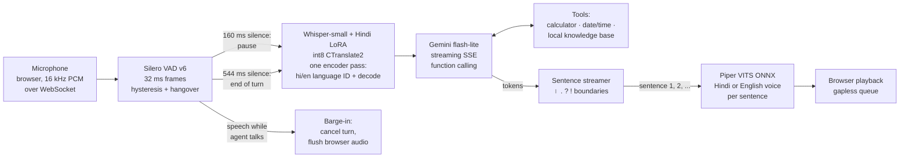

# Hinglish voice agent

Ask a question out loud in Hindi, English or a mix of both, and hear a spoken answer. Everything except the language model runs on a laptop CPU, and every latency figure below is measured end to end on fixed recordings, not estimated.

## The problem, in plain language

Talking to a computer feels natural only when it answers quickly and understands the way people actually speak. For hundreds of millions of people in India that means Hinglish: *"मेरा बिल चार हज़ार रुपये है, इसे पाँच दोस्तों में split करो"*. Most voice assistants handle one language at a time, run on large GPU servers, and quote latency numbers that leave out parts of the round trip.

This project is a complete voice loop that runs on an ordinary laptop:

1. It **listens** and works out by itself when you have finished speaking.
2. It **transcribes** Hindi, English or code-mixed speech with a small Whisper model that I fine-tuned for Hindi.
3. It **thinks** with a small LLM that can use tools: a calculator, the clock and a local knowledge base.
4. It **speaks** the answer in a Hindi or English voice, starting with the first sentence while the rest is still being written.
5. You can **interrupt** it by talking over it, as you would interrupt a person.

It also reports how long each of those steps took, on a fixed set of test recordings, on the CPU named below.

## How it works



One turn, step by step:

1. **Voice activity detection.** The browser sends 16 kHz audio in small chunks. Silero VAD scores each 32 ms frame. Speech starts after 192 ms above a 0.5 threshold, and the turn ends after 544 ms below 0.35. 320 ms of audio from before the start is kept so the first syllable is not clipped.
2. **Speculative transcription.** After the first 160 ms of silence the VAD emits a *pause* event with the audio cut exactly as the end of turn would cut it, and decoding starts right away. If the user stays quiet, the turn reuses that transcript. If they keep talking, it is thrown away.
3. **Speech-to-text.** The fine-tuned Whisper-small ([Dratinia/whisper-small-hindi-lora](https://huggingface.co/Dratinia/whisper-small-hindi-lora), from my [hindi-voice-asr](https://github.com/Abhigyan1805/hindi-voice-asr) project), merged and converted to int8 CTranslate2 (250 MB). The encoder runs **once**. Whisper's language-ID head picks Hindi or English from that encoder output, and the decoder reuses it.
4. **LLM with tools.** The transcript and a short rolling history go to Gemini flash-lite (free tier) over a streaming endpoint. The model can call `calculator`, `get_datetime` or `search_knowledge`. Tool results go back in the same turn, and the reply streams token by token. The system prompt asks for one to three short spoken sentences in the user's language, Devanagari for Hindi, with no markdown.
5. **Sentence streaming.** Tokens are cut into sentences at `। ॥ . ! ?` and newlines. The cutter knows about decimals and abbreviations, merges very short pieces after the first, and splits run-on sentences at commas. Each sentence goes to TTS as soon as it is complete, so the first one plays while the LLM is still writing the rest.
6. **Text-to-speech.** Piper (VITS exported to ONNX, 63 MB per voice) synthesises each sentence with a Hindi voice (`hi_IN-priyamvada-medium`) or an English voice (`en_US-lessac-medium`), chosen by script. espeak-ng's Hindi phonemiser reads digits in Hindi and pronounces Latin-script English words in English, so code-mixed sentences stay on the Hindi voice.
7. **Barge-in.** The VAD keeps running while the agent talks. Speech start during a reply cancels the LLM stream and the TTS loop at the next token or sentence, and tells the browser to drop its queued audio. The cut-off reply is kept in history, marked `[interrupted]`.

## Results at a glance

Laptop CPU (Intel i5-11300H, 4 STT threads, WSL2, shared with other jobs). LLM: `gemini-3.5-flash-lite` on the free tier, live calls, cache off. Latency comes from 56 turns: 20 spoken question prompts and 8 real FLEURS sentences, two rounds each, with the audio fed in real time. Source: [results/RESULTS.md](results/RESULTS.md), generated from the JSON files next to it.

| | p50 | p95 |
|---|---:|---:|
| **End of speech → first reply audio**, all 56 turns | **7.43 s** | **17.11 s** |
| … short spoken questions only (40 turns, median 2.9 s of speech) | 6.54 s | 11.44 s |
| … the same, across three full benchmark runs | 4.9–6.5 s | 9.2–11.4 s |
| Speech-to-text, time left after the end of the turn | 2.24 s | 10.82 s |
| LLM first token (includes tool round trips) | 2.99 s | 6.02 s |
| Text-to-speech, first sentence | 0.28 s | 0.75 s |

| Other measurements | |
|---|---|
| Word error rate, 100 held-out FLEURS Hindi test clips (19.5 min) | **27.38 %** (CER 11.82 %) |
| Hindi/English language ID from one encoder pass | 56/56 benchmark turns, 0 of 100 Hindi clips mistaken for English |
| Correct tool chosen (calculator, date/time, knowledge base) | 22/22 tool prompts |
| Peak RAM, whole agent process during the benchmark | **1.10 GB** (STT-only evaluation: 0.76 GB) |
| Speculative STT, decode time moved off the critical path | 0.384 s on every turn |

### LLM provider comparison: Gemini vs DeepSeek

The same 56 turns were rerun with DeepSeek (`deepseek-flash`, OpenAI-compatible streaming API) as the LLM, with everything else unchanged. One run per provider, back to back, so the machine load and the services' own variation differ between runs.

| LLM | Turns with a reply | LLM first token p50 / p95 | End of speech → first audio p50 / p95 | Tokens per turn (prompt / completion) | Cost per turn | Right tool used |
|---|---:|---:|---:|---:|---:|---:|
| Gemini 3.5 flash-lite, free tier | 56/56 | 2.99 s / 6.02 s | 7.43 s / 17.11 s | not recorded | USD 0 (free tier) | 22/22 |
| DeepSeek flash, provider default (thinking on) | 51/56 | 2.11 s / 3.22 s | 5.90 s / 11.65 s | 1271 / 218 | about USD 0.0001 to 0.0002 | 21/22 |
| DeepSeek flash, thinking off | 56/56 | **0.88 s / 1.97 s** | **4.17 s / 9.44 s** | 1095 / 78 | about USD 0.0001 to 0.0002 | 16/22 |

What this shows, and what it does not:

- DeepSeek is faster and much steadier than the Gemini free tier: LLM first token drops from 2.99 s to 2.11 s (default) or 0.88 s (thinking off) at the median, and the p95 roughly halves or better. Median time to first audio falls from 7.43 s to 4.17 s with thinking off. The remaining time is speech recognition, which the LLM choice does not touch.
- With the provider's default thinking mode on, the model spends completion tokens on reasoning before it speaks. On 5 of the 56 turns it used the whole 400-token cap on reasoning and returned no reply at all (those turns are excluded from the latency figures of that row, so the row flatters it). Turning thinking off fixed that, cut completion tokens from 218 to 78 per turn, and gave the fastest first token.
- Thinking off has a cost in quality: the model answered from memory instead of calling the knowledge-base tool on 5 of 8 knowledge questions (3/8 correct tool use, versus 8/8 for Gemini and for DeepSeek with thinking on). Calculator and date/time were unaffected. For a voice agent I would still pick thinking off for latency, and fix the tool use in the system prompt rather than pay for reasoning on every turn. I did not do that here.
- Cost: Gemini was free. For DeepSeek, about 224 turns across four runs (two were interrupted and rerun) took the balance from USD 0.68 to 0.65, so roughly USD 0.00013 per turn; the balance is shown only to the cent, so read it as 0.0001 to 0.0002. Total spend stayed under the USD 0.05 budget.
- One run per provider on a shared machine and one service on each side, so small gaps are noise. The tables above and in [results/RESULTS.md](results/RESULTS.md) are the Gemini final run unless stated; the DeepSeek raw data are `results/bench-deepseek-*.json`. Reproduce with `python scripts/bench.py --provider deepseek --model deepseek-flash --thinking off --tag deepseek-nothink`.

Where the time goes for a typical short question (medians, synthetic prompts): 0.55 s waiting to be sure you have stopped, 1.80 s of speech recognition left after that, 3.20 s for the LLM to produce its first sentence, and 0.26 s to synthesise it. **The free-tier LLM is the largest and least predictable part.** Its median first-token time was 1.64 s in one full run and 2.99 s in the final run, on the same prompts. Speech recognition comes next, and it grows with utterance length: 4.65 s median for the 8 s FLEURS sentences.

## Detailed results

All tables are produced by `python scripts/report.py` and are copied in full in [results/RESULTS.md](results/RESULTS.md). Per-turn rows (transcript, reply, every timing, load average, free memory, which LLM model answered) are in `results/bench-main.json`.

### End-to-end latency, by group (final run)

| Turns | n | p50 | p95 |
|---|---:|---:|---:|
| All | 56 | 7.43 s | 17.11 s |
| No tool call | 34 | 6.28 s | 16.29 s |
| With a tool call (two LLM requests) | 22 | 7.77 s | 17.47 s |
| Synthetic spoken questions | 40 | 6.54 s | 11.44 s |
| FLEURS real read speech (median 8.2 s long) | 16 | 8.71 s | 17.18 s |
| Hindi | 34 | 8.12 s | 17.29 s |
| Hinglish | 12 | 6.93 s | 10.23 s |
| English | 10 | 6.28 s | 13.53 s |

LLM first token: p50 2.12 s without a tool call and 4.69 s with one. Across the three full runs on the same prompts, the median LLM first token moved between 1.64 s and 2.99 s, and the end-to-end median between 5.39 s and 7.43 s. A fourth, shorter run with speculative STT off happened to meet a slower LLM (first token p50 4.38 s), so it cannot isolate the effect of speculation. The within-turn measurement in the table above can: decode time moved off the critical path, 0.384 s on all 56 turns.

**What sentence streaming buys here.** Flash-lite writes a short reply almost all at once: the median gap between its first complete sentence and the end of the reply is 0.09 s. So streaming saves little LLM time with this model. The saving is on the TTS side. Only the first sentence has to be synthesised before audio starts (0.26 s), while the full reply is 12 s of audio on multi-sentence turns. With a slower or more verbose LLM the gap would be larger.

### Speech recognition (held-out Hindi)

FLEURS hi_in **test** clips 150–249 in file-name order: 100 clips, 19.5 minutes of real read speech. The test split was not used for training or model selection, and clips 0–149 were the CPU benchmark subset in the fine-tuning repo, so this slice is new to both projects.

| Decoding | WER | CER | RTF | Latency p50 | Latency p95 |
|---|---:|---:|---:|---:|---:|
| Language forced to Hindi | 27.38 % | 11.82 % | 0.294 | 3.35 s | 4.71 s |
| Agent setting: one encoder pass, Hindi/English ID, then decode | 27.38 % | 11.82 % | 0.306 | 3.45 s | 5.02 s |

The language-ID step costs about 3 % in time and changes no transcript on Hindi speech. On English questions it is what makes recognition work at all. For reference, the fine-tuning repo reports 26.12 % WER for the same int8 model on clips 0–149. Text is normalised the same way in both repos (Unicode NFC, punctuation and danda removed); Whisper's default normaliser would strip Devanagari vowel signs and under-count errors.

A bug worth recording: the first run of this evaluation gave 48 % WER. Devanagari costs about one Whisper token per character, and my 200-token decode cap cut 28 of 100 transcripts off mid-word. Raising the cap to the decoder's 448-token limit fixed it, and short questions still stop early at the end token, so they lose nothing.

### Text-to-speech

| Voice | Real-time factor | Synthesis per sentence | Round-trip WER / CER |
|---|---:|---:|---:|
| `hi_IN-priyamvada-medium` (agent's Hindi voice) | 0.049 | 0.18 s | 30.8 % / 16.7 % |
| `hi_IN-pratham-medium` | 0.052 | 0.16 s | 24.2 % / 15.0 % |
| `hi_IN-rohan-medium` | 0.050 | 0.18 s | 28.6 % / 16.5 % |
| `en_US-lessac-medium` (agent's English voice) | 0.061 | 0.15 s | 27.9 % / 22.5 % |

Round trip: fixed sentences are synthesised, transcribed by the agent's own recogniser and scored against the input text. It is a rough intelligibility proxy that inherits the recogniser's errors. With 10 Hindi sentences, and VITS sampling noise that moves the numbers by a few points between runs, it does not separate the three Hindi voices. English CER is inflated because the recogniser writes "1081" where the text says "one thousand and eighty one". Piper synthesises about 20 times faster than real time, so TTS is never the bottleneck.

### Memory

| Process | Peak RSS |
|---|---:|
| Full agent during the 56-turn benchmark (STT + both voices + VAD + LLM client) | 1,095 MB |
| Same, before turning off ONNX Runtime's memory arena for the voices | 1,542 MB |
| STT-only WER evaluation | 763 MB |

The arena fix: with ONNX Runtime's default CPU memory arena, each new sentence length grew Piper's cached buffers. Synthesising the benchmark's 90 reply sentences took the two voices from 250 MB to 905 MB resident. With the arena off they settle at 347 MB, at the same speed.

## Design decisions

- **Measure the whole round trip, in real time.** The benchmark feeds each recording to the VAD at microphone pace, in 32 ms frames, and times by wall clock from the moment the last speech frame arrives to the moment the first reply audio is ready. That includes the end-of-turn wait, which many published numbers leave out.
- **One encoder pass for language ID.** Forcing `language="hi"` turned English questions into Devanagari gibberish ("व्या पर च्कर्व रूट 144…" for "What is the square root of 144…"). faster-whisper's auto-detection fixes that but runs the encoder twice (about +1 s). Reading the language-ID head from the encoder output that the decoder already uses adds only about 3 % to decode time (measured on the WER set). It picked the right language on all 56 benchmark turns and did not mistake any of the 100 held-out Hindi clips for English.
- **Speculative STT** moves part of the decode into the end-of-turn wait: 0.384 s per turn, measured inside each turn.
- **A Gemini model fallback.** During this work `gemini-3.1-flash-lite` returned HTTP 503 ("high demand") for every request for a while. The client now tries the configured model with two retries, falls back to the next free model, and stays there for five minutes. Each turn records which model answered.
- **Tool errors are data, not exceptions.** The calculator parses with `ast`, never `eval`, accepts `×`, `÷`, `%`, `18% of 1250` and Devanagari digits, and returns `{"error": ...}` so the LLM can recover. An LLM failure is spoken as a short apology instead of silence.
- **Bounded memory.** One STT model, two small TTS voices and a 2 MB VAD, loaded once. The evaluation reads FLEURS through a child process because the 300 MB single-row-group parquet alone costs about 1.5 GB to decode.

## Limitations and honest notes

- **CPU only, on a shared machine.** All numbers come from one laptop CPU in WSL2, with other jobs running at the same time (the load average is recorded per turn). A quiet machine or a desktop CPU would be faster, and a GPU much faster.
- **STT is the slowest stage.** Whisper pads every input to a 30 s window, so even a two-second question costs about 2 s of encoder and decoder time on this CPU, and a long sentence costs more because Hindi needs about one token per character. Streaming partial transcripts are not used; the turn is transcribed once it ends, or speculatively at the pause.
- **Small, partly synthetic test set.** The 20 question prompts are synthetic: they are spoken by Piper voices that differ from the reply voices, not by people. The 8 real-speech prompts are FLEURS read sentences, not questions. They show the cost of long real utterances, not conversational behaviour. WER uses 100 FLEURS clips, about 20 minutes of clean read speech. Conversational, noisy or strongly code-mixed speech will do worse.
- **Recognition errors reach the answer.** Example from the benchmark: *"तेईस गुणा सैंतालीस"* (23 × 47) was heard as *"टीज़ गुणा 47"*, so the agent confidently computed 30 × 47. In a live check, "online fraud" in a Hinglish question came out as "अनलैंड फ़ॉथ", and the agent gave the general emergency number 112 instead of the cyber-fraud helpline 1930. The fine-tuned model also writes many English words in Devanagari, sometimes misspelt ("split" became "स्पृत"), because its FLEURS training data does the same.
- **Free-tier LLM.** (DeepSeek is faster and steadier, see the comparison above, but it is a paid API and was tested in a single run.) Gemini free-tier latency varies by several seconds from request to request and with demand, and the API can shed load (HTTP 503) or rate-limit (HTTP 429). The client retries with back-off and falls back to another model, but LLM time-to-first-token is the noisiest number here. A turn that calls a tool pays for two LLM round trips.
- **Barge-in needs headphones.** Browser echo cancellation does not reliably remove Web Audio playback, so on laptop speakers the agent can hear itself and stop. The UI has an "allow interrupting" switch that makes it half-duplex. Barge-in is covered by unit tests (WebSocket protocol, cancellation, history) and by `scripts/smoke_ws.py`, which streams a recorded question to the running server in real time and then talks over the reply. I could not drive it from a real browser with a real microphone in the environment where this was built, so the browser audio path (worklet capture, playback queue, echo) is the least tested part.
- **Voice licences are non-commercial.** The Hindi Piper voices are trained on CC BY-NC-SA data, and `rohan` on IIT Madras IndicTTS data under its own licence. That is fine for a portfolio demo, not for a product. The pipeline does not depend on a particular voice: point `VOICE_AGENT_TTS_HI` at any Piper voice.
- **Not deployed.** This is a local demo. No users, uptime or production traffic are claimed.

## How to run

Requirements: tested with Python 3.12 (the wheels for `ctranslate2` and `onnxruntime` lag behind new Python releases, so avoid 3.14), about 1.5 GB of free RAM and 600 MB of disk for models.

```bash
python3.12 -m venv .venv && . .venv/bin/activate
pip install -e ".[eval,dev]"

# 1. Speech model: whisper-small + Hindi LoRA, merged, int8 CTranslate2 (needs torch/transformers/peft once, ~2 GB RAM)
pip install torch transformers peft && python scripts/build_stt_model.py
#    or copy an existing build from hindi-voice-asr (python -m hindi_asr.quant convert) to models/whisper-small-hindi-ct2-int8/
#    (every number here used the build from that command; build_stt_model.py follows the same recipe but was not re-run here)

# 2. Piper voices (about 63 MB each)
mkdir -p models/piper && cd models/piper
B=https://huggingface.co/rhasspy/piper-voices/resolve/main
for v in hi/hi_IN/priyamvada/medium/hi_IN-priyamvada-medium en/en_US/lessac/medium/en_US-lessac-medium; do
  curl -LO $B/$v.onnx && curl -LO $B/$v.onnx.json; done
cd ../..

# 3. LLM key (free Gemini key from Google AI Studio). Without one the agent runs an offline rule-based fallback.
echo "GOOGLE_API_KEY=..." > .env          # or point VOICE_AGENT_ENV_FILE at a file elsewhere
```

Talk to it:

```bash
voice-agent serve                         # http://127.0.0.1:8000: live mic, streaming replies, barge-in, typed input
voice-agent ask prompts/audio/hx-calc-3.wav --out reply.wav   # one recorded question, prints per-stage timings
voice-agent chat                          # type questions, replies saved as wav (add --play to play them via aplay)
```

Measure it:

```bash
pytest                                    # unit tests: VAD, sentence streaming, tools, LLM tool loops, pipeline, WebSocket
python scripts/eval_wer.py                # WER/CER on FLEURS hi test clips 150-249 -> results/wer-150-250.json
python scripts/bench.py --rounds 2        # end-to-end latency -> results/bench-main.json
python scripts/bench.py --rounds 1 --no-speculative --tag nospec
python scripts/eval_tts.py                # Piper speed + round-trip intelligibility -> results/tts.json
python scripts/smoke_ws.py                # against a running `voice-agent serve --port 8765`: typed turn, spoken turn, barge-in
python scripts/make_prompts.py            # regenerate the synthetic prompt recordings (needs the pratham/rohan/ryan voices)
```

FLEURS is read from the Hugging Face cache (`google/fleurs`, `parquet-data/hi_in/test-*`) or from `FLEURS_HI_TEST=/path/to/test.parquet`.

Configuration, all through environment variables: `VOICE_AGENT_LLM` (`auto`, `gemini`, `openai` for any OpenAI-compatible endpoint such as DeepSeek or a local vLLM, or `offline`), `VOICE_AGENT_LLM_MODEL`, `VOICE_AGENT_LLM_CACHE=0`, `VOICE_AGENT_STT`, `VOICE_AGENT_STT_THREADS`, `VOICE_AGENT_TTS_HI`, `VOICE_AGENT_TTS_EN`. Keys are read from the environment or the env file and are never logged. LLM responses are cached on disk under `cache/llm/` for development; the benchmarks turn the cache off.

## Project layout

```
src/voice_agent/
  config.py     paths and settings (environment variables), .env loading
  audio.py      wav I/O, resampling, PCM conversion
  vad.py        streaming VAD segmenter (Silero ONNX or energy scorer), pause/end events
  stt.py        int8 Whisper: single encoder pass, hi/en language ID, greedy decode, loop guard
  llm.py        Gemini SSE client with tool loop and model fallback; OpenAI-compatible client; offline client; disk cache, back-off
  tools.py      calculator (AST), date/time, trigram knowledge base; JSON-schema declarations
  agent.py      system prompt and rolling history
  text.py       sentence streamer, speech cleanup, script detection
  tts.py        Piper voices, per-sentence voice routing
  pipeline.py   one turn: STT -> LLM producer thread -> sentence TTS, cancellation, metrics
  server.py     FastAPI + WebSocket protocol, barge-in; static/index.html is the browser client
  factory.py    builds the pipeline from settings
  fleurs.py     low-memory FLEURS loader and the scoring normaliser
  cli.py        ask / chat / serve
scripts/        bench.py, eval_wer.py, eval_tts.py, report.py, smoke_ws.py, make_prompts.py, build_stt_model.py
prompts/        prompts.json and the 20 synthetic prompt recordings (16 kHz wav)
results/        benchmark and evaluation JSON (per-turn rows included), RESULTS.md;
                superseded/ holds the earlier benchmark runs quoted in the run-to-run comparison
tests/          pytest suite (no models or network needed)
```

## Licences and data

Code: MIT. Speech model: OpenAI Whisper-small (MIT) with my LoRA adapter, trained on Google FLEURS (CC BY 4.0). Evaluation audio: FLEURS hi_in test split (CC BY 4.0). VAD: Silero VAD (MIT), as bundled with faster-whisper. TTS engine: Piper (`piper-tts`, GPL-3.0, with espeak-ng). Voices: `hi_IN-priyamvada-medium` and `hi_IN-pratham-medium` (CC BY-NC-SA 4.0 data), `hi_IN-rohan-medium` (IIT Madras IndicTTS licence), `en_US-lessac-medium` (Blizzard 2013 Lessac licence) and `en_US-ryan-medium` (CC BY-NC-SA 4.0). The pratham, rohan and ryan voices are used only to render the synthetic test prompts.
