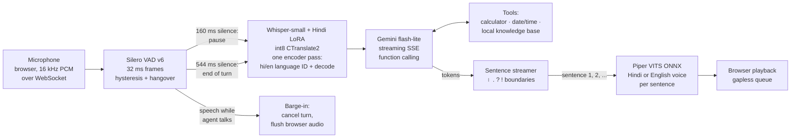

# Hinglish voice agent

Ask a question out loud in Hindi, English or a mix of both, and hear a spoken answer. Everything except the language model runs on a laptop CPU, and every latency figure below is measured end to end on fixed recordings, not estimated.

## The problem, in plain language

Talking to a computer feels natural only when it answers quickly and understands the way people actually speak. For hundreds of millions of people in India that means Hinglish: *"मेरा बिल चार हज़ार रुपये है, इसे पाँच दोस्तों में split करो"*. Most voice assistants handle one language at a time, run on large GPU servers, and quote latency numbers that leave out parts of the round trip.

This project is a complete voice loop that runs on an ordinary laptop:

1. It **listens** and works out by itself when you have finished speaking.
2. It **transcribes** Hindi, English or code-mixed speech with a small Whisper model that I fine-tuned for Hindi.
3. It **thinks** with a small LLM that can use tools: a calculator, the clock and a local knowledge base.
4. It **speaks** the answer in a Hindi or English voice, starting with the first sentence while the rest is still being written.
5. You can **interrupt** it by talking over it, as you would interrupt a person.

It also reports how long each of those steps took, on a fixed set of test recordings, on the CPU named below.

## How it works



One turn, step by step:

1. **Voice activity detection.** The browser sends 16 kHz audio in small chunks. Silero VAD scores each 32 ms frame. Speech starts after 192 ms above a 0.5 threshold, and the turn ends after 544 ms below 0.35. 320 ms of audio from before the start is kept so the first syllable is not clipped.
2. **Speculative transcription.** After the first 160 ms of silence the VAD emits a *pause* event with the audio cut exactly as the end of turn would cut it, and decoding starts right away. If the user stays quiet, the turn reuses that transcript. If they keep talking, it is thrown away.
3. **Speech-to-text.** The fine-tuned Whisper-small ([Dratinia/whisper-small-hindi-lora](https://huggingface.co/Dratinia/whisper-small-hindi-lora), from my [hindi-voice-asr](https://github.com/Abhigyan1805/hindi-voice-asr) project), merged and converted to int8 CTranslate2 (250 MB). The encoder runs **once**. Whisper's language-ID head picks Hindi or English from that encoder output, and the decoder reuses it.
4. **LLM with tools.** The transcript and a short rolling history go to Gemini flash-lite (free tier) over a streaming endpoint. The model can call `calculator`, `get_datetime` or `search_knowledge`. Tool results go back in the same turn, and the reply streams token by token. The system prompt asks for one to three short spoken sentences in the user's language, Devanagari for Hindi, with no markdown.
5. **Sentence streaming.** Tokens are cut into sentences at `। ॥ . ! ?` and newlines. The cutter knows about decimals and abbreviations, merges very short pieces after the first, and splits run-on sentences at commas. Each sentence goes to TTS as soon as it is complete, so the first one plays while the LLM is still writing the rest.
6. **Text-to-speech.** Piper (VITS exported to ONNX, 63 MB per voice) synthesises each sentence with a Hindi voice (`hi_IN-priyamvada-medium`) or an English voice (`en_US-lessac-medium`), chosen by script. espeak-ng's Hindi phonemiser reads digits in Hindi and pronounces Latin-script English words in English, so code-mixed sentences stay on the Hindi voice.
7. **Barge-in.** The VAD keeps running while the agent talks. Speech start during a reply cancels the LLM stream and the TTS loop at the next token or sentence, and tells the browser to drop its queued audio. The cut-off reply is kept in history, marked `[interrupted]`.

## Results at a glance

The block below is generated from the JSON files in `results/` by `python scripts/report.py --readme`, and a unit test fails if it is out of date. The tables after it describe the original Gemini build.

<!-- results:begin -->
<!-- generated by scripts/report.py --readme; do not edit by hand -->

### Latency: what each change bought

End of speech to first reply audio, measured by wall clock with the audio fed in real time (`scripts/bench.py`, 20 spoken questions + 8 FLEURS sentences, 2 rounds = 56 turns). One run per row on a shared laptop CPU; the LLM is a live API, so gaps under about 0.5 s are within run-to-run noise.

| Configuration | Turns without error | E2E p50 | E2E p95 | End-of-turn wait p50 | STT left p50 | LLM first sentence p50 | TTS first p50 | Tool used as expected | Knowledge-base tool |
|---|---:|---:|---:|---:|---:|---:|---:|---:|---:|
| Gemini 3.5 flash-lite (free tier), original code | 56/56 | **7.43 s** | 17.11 s | 0.55 s | 2.24 s | 3.20 s | 0.28 s | 22/22 | 8/8 |
| DeepSeek flash, thinking off, original prompt | 56/56 | **4.17 s** | 9.44 s | 0.55 s | 1.97 s | 1.18 s | 0.26 s | 16/22 | 3/8 |
| + tool section in the system prompt | 56/56 | **4.05 s** | 8.63 s | 0.55 s | 1.89 s | 1.25 s | 0.24 s | 22/22 | 8/8 |
| + short STT window (end-of-turn sweep kept 544 ms) | 54/56 | **2.67 s** | 6.38 s | 0.55 s | 0.51 s | 1.19 s | 0.24 s | 22/22 | 8/8 |

Latency percentiles are over the turns without error. Errors are LLM requests that failed or hit the voice timeout (8 s without data); the agent speaks a short apology on those turns. + short STT window (end-of-turn sweep kept 544 ms): ReadTimeout: The read operation timed out, ConnectTimeout: timed out.

Last row: STT window utterance + 5 s below 12 s (2 of 56 turns fell back to 30 s), VAD end-of-turn 544 ms, speculative STT at 160 ms (44 speculative decodes wasted). LLM tokens for the run: 80467 prompt, 4375 completion.

### Tool routing, text only

`scripts/eval_tools.py`: each input goes straight to the LLM (deepseek-flash, thinking off) as the first turn of a call, 3 repetitions, cache off. Inputs: 28 benchmark transcripts as the recogniser heard them, the same 28 as written, and 21 more utterances (tool and no-tool, 3 deliberately garbled). v1 is the original one-sentence tool rule; v2 is the current tool section.

| Prompt | Tool used when needed | Calculator | Date/time | Knowledge base | Unnecessary tool calls | First token p50, no tool / tool |
|---|---:|---:|---:|---:|---:|---:|
| v1 | 83/102 | 34/36 | 26/27 | 23/39 | 0/129 | 0.66 s / 1.47 s |
| v2 | 100/102 | 36/36 | 25/27 | 39/39 | 0/129 | 0.67 s / 1.49 s |

v2 on the spoken-benchmark transcripts alone: tool used when needed 31/33, unnecessary tool calls 0/51. Tokens for the whole evaluation: 618139 prompt, 36545 completion.

### Speech recognition: FLEURS hi_in test, clips 150-249 in file-name order

100 clips, 19.54 min. `30s` encodes Whisper's full 30 s window; `short` encodes the utterance + 5.0 s and falls back to 30 s when the decode loops or runs too long. Generation stops at 222 tokens, which long Hindi sentences can reach.

| Decoding | WER | CER | Latency p50 | Latency p95 | Fallbacks to 30 s | Hit token limit | Detected as English |
|---|---:|---:|---:|---:|---:|---:|---:|
| 30s/forced-hi | 27.38 % | 11.82 % | 3.31 s | 4.79 s | 0 | 6 | 0 |
| 30s/auto | 27.38 % | 11.82 % | 3.43 s | 4.89 s | 0 | 6 | 0 |
| short/auto | 27.61 % | 11.76 % | 2.48 s | 5.29 s | 4 | 6 | 0 |

### End-of-turn detection

`scripts/eval_endpoint.py`, VAD only: 20 benchmark prompts (Piper) + FLEURS hi_in test clips 150-249, each padded 0.5 s before / 1.5 s after. A premature cut means the VAD ended the turn at a pause before the speaker had finished. Rule: smallest end_silence_ms with 0 premature cuts on the questions and a FLEURS premature-cut rate at most 2.0 percentage points above the 544 ms baseline. Chosen: **544 ms**.

| Silence before end of turn | Questions cut early | FLEURS sentences cut early | Wasted speculative decodes per FLEURS clip |
|---:|---:|---:|---:|
| 256 ms | 2/20 | 53/100 (53 %) | 0.88 |
| 320 ms | 1/20 | 42/100 (42 %) | 1.33 |
| 384 ms | 0/20 | 34/100 (34 %) | 1.58 |
| 448 ms | 0/20 | 25/100 (25 %) | 1.78 |
| 544 ms | 0/20 | 15/100 (15 %) | 1.93 |
| 704 ms | 0/20 | 11/100 (11 %) | 2.02 |

### REST tool under injected faults

`scripts/eval_rest_tool.py`: the order tools' client against the local stand-in order service (src/voice_agent/demo_service.py) over HTTP on 127.0.0.1, no LLM. Client: connect timeout 1 s, read timeout 2.5 s, 5 s budget per tool call, up to 2 retries with jittered back-off. 30 calls per mode. **330/330** calls ended in the expected outcome (the order data, or an error the agent can speak about instead of inventing an answer); 330/330 stayed within the budget.

| Fault | Expected outcome | Correct | Attempts (mean) | Seconds p50 | Seconds max |
|---|---|---:|---:|---:|---:|
| none | ok | 30/30 | 1.0 | 0.00 | 0.00 |
| latency 300 ms | ok | 30/30 | 1.0 | 0.30 | 0.30 |
| one 503, then success | ok | 30/30 | 2.0 | 0.20 | 0.30 |
| two 503s, then success | ok | 30/30 | 3.0 | 0.64 | 0.85 |
| three 503s (more than the retries) | unavailable | 30/30 | 3.0 | 0.61 | 0.89 |
| 429 with Retry-After 1 s | ok | 30/30 | 2.0 | 1.00 | 1.01 |
| malformed body once | ok | 30/30 | 2.0 | 0.20 | 0.30 |
| hang 4 s (longer than the read timeout) | timeout | 30/30 | 2.0 | 5.00 | 5.00 |
| unknown order id | not_found | 30/30 | 1.0 | 0.00 | 0.00 |
| reschedule, one 503 then success | ok | 30/30 | 2.0 | 0.24 | 0.30 |
| reschedule a delivered order | rejected | 30/30 | 1.0 | 0.00 | 0.00 |

### Call quality: scripted multi-turn calls

`scripts/eval_calls.py`: 12 scripted calls (29 caller turns) with the order tools on, each run 3 times. Spoken track: the callers' recorded audio (synthetic Piper voices) through VAD, STT, the LLM (deepseek-flash, thinking off) with tools, and TTS. Oracle track: the same calls with the reference text given to the LLM directly. A call passes when every turn passes every check and the order service ends in the expected state. Each failed spoken call is attributed to the stage that caused its first failing turn (rules below the block).

| Prompt | Calls passed, spoken | Calls passed, oracle text | Spoken, tuning calls | Spoken, held-out calls | Turns passed, spoken | Tool calls correct, spoken / oracle | Failures by stage (spoken) |
|---|---:|---:|---:|---:|---:|---:|---|
| v1 | **5/36** | 25/36 | 5/24 | 0/12 | 42/87 | 28/48 / 47/48 | llm 9, stt 21, tts 1 |
| v2 | **8/36** | 31/36 | 6/24 | 2/12 | 47/87 | 27/48 / 48/48 | llm 2, stt 26 |
| v3 | **10/36** | 32/36 | 6/24 | 4/12 | 50/87 | 28/48 / 47/48 | llm 3, stt 23 |

Latest prompt (v3): per-turn WER median 25.0 % (mean 28.1 %, 24 of 87 turns error-free; digits counted one per token whether spoken as words or written as numbers). Order ids and phone numbers recognised exactly: 18/36 turns. LLM tokens for the run: 528733 prompt, 13976 completion.

| Call | Language | Held out | Passed, spoken | Passed, oracle |
|---|---|---|---:|---:|
| `c01-status-hi` | hi |  | 3/3 | 3/3 |
| `c02-status-en` | en |  | 3/3 | 3/3 |
| `c03-unknown-id` | hi | yes | 0/3 | 3/3 |
| `c04-reschedule-hx` | hinglish |  | 0/3 | 2/3 |
| `c05-delivered-en` | en |  | 0/3 | 3/3 |
| `c06-caller-declines` | hi | yes | 0/3 | 3/3 |
| `c07-retries-en` | en |  | 0/3 | 3/3 |
| `c08-service-hangs` | hi |  | 0/3 | 3/3 |
| `c09-phone-lookup` | en | yes | 1/3 | 0/3 |
| `c10-discount-maths` | hinglish |  | 0/3 | 3/3 |
| `c11-helpline-midcall` | hi |  | 0/3 | 3/3 |
| `c12-scope-and-switch` | hi+en | yes | 3/3 | 3/3 |

Worked failure examples (first failing turn of a call, one per stage, from the latest run):

- **stt** (`c03-unknown-id`, turn 2): caller said "माफ़ कीजिए, सही नंबर है सात दो नौ शून्य पाँच।"; recogniser heard "माफ़ किजे! सही नंबर है साथ दो नौश्य उन्य पाथ्स!"; tools: get_order_status(order_id=72959) -> not_found; reply "माफ़ कीजिए, 72959 भी सिस्टम में नहीं मिला। क्या आप अपना 10 अंकों का फ़ोन नंबर बता सकते हैं, मैं उससे ऑर्डर ढू…". Failed check: tools, reply_any.
- **llm** (`c04-reschedule-hx`, turn 2): caller said "उसे बीस नवंबर को कर दो।"; recogniser heard "उसे 20 नवंबर को कर दो।"; tools: get_order_status(order_id=48813) -> not_found; reply "48813 नंबर से अभी भी कोई ऑर्डर नहीं मिल रहा, इसलिए मैं तारीख़ नहीं बदल सकता। आप अपना 10 अंकों का फ़ोन नंबर बत…". Failed check: reply_any.

### Phone audio: simulated telephone channel

`scripts/eval_wer.py --conditions`: the same 100 FLEURS clips passed through a simulated channel (`src/voice_agent/degrade.py`): `tel` = 300-3400 Hz band-pass, 8 kHz, G.711 mu-law, back to 16 kHz; `opus8` = Opus at 8 kbit/s narrowband after that (no GSM/AMR encoder is available here); `babbleN` / `whiteN` = babble from 6 other FLEURS speakers or white noise at N dB SNR, added before the channel; `loss5` = 5 % of 20 ms frames dropped without concealment. Agent decoding (short window, language ID).

| Condition | WER | CER | Latency p50 | Fallbacks to 30 s | Clips with no speech found / split by the VAD | Detected as English |
|---|---:|---:|---:|---:|---:|---:|
| clean | 27.61 % | 11.76 % | 2.71 s | 4 | 0 / 15 | 0 |
| tel | 32.82 % | 14.91 % | 2.69 s | 1 | 1 / 21 | 0 |
| tel+opus8 | 38.66 % | 18.43 % | 2.55 s | 2 | 1 / 28 | 1 |
| tel+babble15 | 40.47 % | 19.72 % | 2.74 s | 2 | 1 / 19 | 0 |
| tel+babble5 | 74.79 % | 48.39 % | 2.57 s | 3 | 1 / 7 | 1 |
| tel+white10 | 54.16 % | 28.11 % | 2.66 s | 1 | 1 / 21 | 0 |
| tel+loss5 | 34.71 % | 15.76 % | 2.88 s | 1 | 0 / 29 | 0 |

Call suite on the same channel (spoken track; the oracle-text track does not depend on audio and is reused from the clean run):

| Audio | Calls passed, spoken | Turns passed | Tool calls correct | Per-turn WER median | Order/phone digits heard | Failures by stage |
|---|---:|---:|---:|---:|---:|---|
| clean | **10/36** | 50/87 | 28/48 | 25.0 % | 18/36 | llm 3, stt 23 |
| tel | **13/36** | 56/87 | 33/48 | 25.0 % | 18/36 | llm 2, stt 20, tts 1 |
| tel-babble15 | **9/36** | 47/87 | 29/48 | 40.0 % | 12/36 | llm 3, stt 23, vad 1 |

### Misheard digits: before and after the fix

Same 12 calls and 3 repetitions, with a reactive simulated caller: when the agent reads back a wrong order id or phone number, or asks for it again, the caller repeats it slowly digit by digit (at most twice), and confirms a correct read-back. A turn passes with at most one repeat. "Before" is the v3 prompt with no number handling (`VOICE_AGENT_DIGIT_FIX=0`); "after" adds spoken-number normalisation of the transcript, a digit hint to the recogniser on the turn after the agent asks for a number, and a read-back-and-confirm rule in the prompt. Exact id on first try: the 5-digit id or 10-digit phone number appears as one digit string in what the LLM received from the caller's first attempt.

| Run | Calls passed, spoken | Held-out calls, spoken | Calls passed, oracle | Exact id on first try | Right id reached the order tool | Id turns with 0 / 1 / 2 repeats | Failures by stage |
|---|---:|---:|---:|---:|---:|---:|---|
| before, clean | **13/36** | 4/12 | 32/36 | 15/39 | 21/39 | 28 / 8 / 3 | llm 4, stt 16, tts 3 |
| after, clean | **19/36** | 5/12 | 31/36 | 15/39 | 25/39 | 24 / 13 / 2 | llm 2, stt 13, tts 2 |
| before, telephone | **14/36** | 4/12 | 32/36 | 12/39 | 24/39 | 26 / 9 / 4 | llm 2, stt 19, tts 1 |
| after, telephone | **16/36** | 3/12 | 31/36 | 15/39 | 25/39 | 28 / 7 / 4 | llm 3, stt 15, tts 2 |

<!-- results:end -->

Laptop CPU (Intel i5-11300H, 4 STT threads, WSL2, shared with other jobs). LLM: `gemini-3.5-flash-lite` on the free tier, live calls, cache off. Latency comes from 56 turns: 20 spoken question prompts and 8 real FLEURS sentences, two rounds each, with the audio fed in real time. Source: [results/RESULTS.md](results/RESULTS.md), generated from the JSON files next to it.

| | p50 | p95 |
|---|---:|---:|
| **End of speech → first reply audio**, all 56 turns | **7.43 s** | **17.11 s** |
| … short spoken questions only (40 turns, median 2.9 s of speech) | 6.54 s | 11.44 s |
| … the same, across three full benchmark runs | 4.9–6.5 s | 9.2–11.4 s |
| Speech-to-text, time left after the end of the turn | 2.24 s | 10.82 s |
| LLM first token (includes tool round trips) | 2.99 s | 6.02 s |
| Text-to-speech, first sentence | 0.28 s | 0.75 s |

| Other measurements | |
|---|---|
| Word error rate, 100 held-out FLEURS Hindi test clips (19.5 min) | **27.38 %** (CER 11.82 %) |
| Hindi/English language ID from one encoder pass | 56/56 benchmark turns, 0 of 100 Hindi clips mistaken for English |
| Correct tool chosen (calculator, date/time, knowledge base) | 22/22 tool prompts |
| Peak RAM, whole agent process during the benchmark | **1.10 GB** (STT-only evaluation: 0.76 GB) |
| Speculative STT, decode time moved off the critical path | 0.384 s on every turn |

### LLM provider comparison: Gemini vs DeepSeek

The same 56 turns were rerun with DeepSeek (`deepseek-flash`, OpenAI-compatible streaming API) as the LLM, with everything else unchanged. One run per provider, back to back, so the machine load and the services' own variation differ between runs.

| LLM | Turns with a reply | LLM first token p50 / p95 | End of speech → first audio p50 / p95 | Tokens per turn (prompt / completion) | Cost per turn | Right tool used |
|---|---:|---:|---:|---:|---:|---:|
| Gemini 3.5 flash-lite, free tier | 56/56 | 2.99 s / 6.02 s | 7.43 s / 17.11 s | not recorded | USD 0 (free tier) | 22/22 |
| DeepSeek flash, provider default (thinking on) | 51/56 | 2.11 s / 3.22 s | 5.90 s / 11.65 s | 1271 / 218 | about USD 0.0001 to 0.0002 | 21/22 |
| DeepSeek flash, thinking off | 56/56 | **0.88 s / 1.97 s** | **4.17 s / 9.44 s** | 1095 / 78 | about USD 0.0001 to 0.0002 | 16/22 |

What this shows, and what it does not:

- DeepSeek is faster and much steadier than the Gemini free tier: LLM first token drops from 2.99 s to 2.11 s (default) or 0.88 s (thinking off) at the median, and the p95 roughly halves or better. Median time to first audio falls from 7.43 s to 4.17 s with thinking off. The remaining time is speech recognition, which the LLM choice does not touch.
- With the provider's default thinking mode on, the model spends completion tokens on reasoning before it speaks. On 5 of the 56 turns it used the whole 400-token cap on reasoning and returned no reply at all (those turns are excluded from the latency figures of that row, so the row flatters it). Turning thinking off fixed that, cut completion tokens from 218 to 78 per turn, and gave the fastest first token.
- Thinking off has a cost in quality: the model answered from memory instead of calling the knowledge-base tool on 5 of 8 knowledge questions (3/8 correct tool use, versus 8/8 for Gemini and for DeepSeek with thinking on). Calculator and date/time were unaffected. For a voice agent I would still pick thinking off for latency, and fix the tool use in the system prompt rather than pay for reasoning on every turn. I did not do that here.
- Cost: Gemini was free. For DeepSeek, about 224 turns across four runs (two were interrupted and rerun) took the balance from USD 0.68 to 0.65, so roughly USD 0.00013 per turn; the balance is shown only to the cent, so read it as 0.0001 to 0.0002. Total spend stayed under the USD 0.05 budget.
- One run per provider on a shared machine and one service on each side, so small gaps are noise. The tables above and in [results/RESULTS.md](results/RESULTS.md) are the Gemini final run unless stated; the DeepSeek raw data are `results/bench-deepseek-*.json`. Reproduce with `python scripts/bench.py --provider deepseek --model deepseek-flash --thinking off --tag deepseek-nothink`.

Where the time goes for a typical short question (medians, synthetic prompts): 0.55 s waiting to be sure you have stopped, 1.80 s of speech recognition left after that, 3.20 s for the LLM to produce its first sentence, and 0.26 s to synthesise it. **The free-tier LLM is the largest and least predictable part.** Its median first-token time was 1.64 s in one full run and 2.99 s in the final run, on the same prompts. Speech recognition comes next, and it grows with utterance length: 4.65 s median for the 8 s FLEURS sentences.

## Detailed results

All tables are produced by `python scripts/report.py` and are copied in full in [results/RESULTS.md](results/RESULTS.md). Per-turn rows (transcript, reply, every timing, load average, free memory, which LLM model answered) are in `results/bench-main.json`.

### End-to-end latency, by group (final run)

| Turns | n | p50 | p95 |
|---|---:|---:|---:|
| All | 56 | 7.43 s | 17.11 s |
| No tool call | 34 | 6.28 s | 16.29 s |
| With a tool call (two LLM requests) | 22 | 7.77 s | 17.47 s |
| Synthetic spoken questions | 40 | 6.54 s | 11.44 s |
| FLEURS real read speech (median 8.2 s long) | 16 | 8.71 s | 17.18 s |
| Hindi | 34 | 8.12 s | 17.29 s |
| Hinglish | 12 | 6.93 s | 10.23 s |
| English | 10 | 6.28 s | 13.53 s |

LLM first token: p50 2.12 s without a tool call and 4.69 s with one. Across the three full runs on the same prompts, the median LLM first token moved between 1.64 s and 2.99 s, and the end-to-end median between 5.39 s and 7.43 s. A fourth, shorter run with speculative STT off happened to meet a slower LLM (first token p50 4.38 s), so it cannot isolate the effect of speculation. The within-turn measurement in the table above can: decode time moved off the critical path, 0.384 s on all 56 turns.

**What sentence streaming buys here.** Flash-lite writes a short reply almost all at once: the median gap between its first complete sentence and the end of the reply is 0.09 s. So streaming saves little LLM time with this model. The saving is on the TTS side. Only the first sentence has to be synthesised before audio starts (0.26 s), while the full reply is 12 s of audio on multi-sentence turns. With a slower or more verbose LLM the gap would be larger.

### Speech recognition (held-out Hindi)

FLEURS hi_in **test** clips 150–249 in file-name order: 100 clips, 19.5 minutes of real read speech. The test split was not used for training or model selection, and clips 0–149 were the CPU benchmark subset in the fine-tuning repo, so this slice is new to both projects.

| Decoding | WER | CER | RTF | Latency p50 | Latency p95 |
|---|---:|---:|---:|---:|---:|
| Language forced to Hindi | 27.38 % | 11.82 % | 0.294 | 3.35 s | 4.71 s |
| Agent setting: one encoder pass, Hindi/English ID, then decode | 27.38 % | 11.82 % | 0.306 | 3.45 s | 5.02 s |

The language-ID step costs about 3 % in time and changes no transcript on Hindi speech. On English questions it is what makes recognition work at all. For reference, the fine-tuning repo reports 26.12 % WER for the same int8 model on clips 0–149. Text is normalised the same way in both repos (Unicode NFC, punctuation and danda removed); Whisper's default normaliser would strip Devanagari vowel signs and under-count errors.

A bug worth recording: the first run of this evaluation gave 48 % WER. Devanagari costs about one Whisper token per character, and my 200-token decode cap cut 28 of 100 transcripts off mid-word. Raising the requested cap to 444 tokens fixed most of it. Generation actually stops at 222 tokens (half the 448-token decoder context), which very long Hindi sentences can still reach; the WER evaluation now counts those clips. Short questions stop early at the end token, so they lose nothing.

### Text-to-speech

| Voice | Real-time factor | Synthesis per sentence | Round-trip WER / CER |
|---|---:|---:|---:|
| `hi_IN-priyamvada-medium` (agent's Hindi voice) | 0.049 | 0.18 s | 30.8 % / 16.7 % |
| `hi_IN-pratham-medium` | 0.052 | 0.16 s | 24.2 % / 15.0 % |
| `hi_IN-rohan-medium` | 0.050 | 0.18 s | 28.6 % / 16.5 % |
| `en_US-lessac-medium` (agent's English voice) | 0.061 | 0.15 s | 27.9 % / 22.5 % |

Round trip: fixed sentences are synthesised, transcribed by the agent's own recogniser and scored against the input text. It is a rough intelligibility proxy that inherits the recogniser's errors. With 10 Hindi sentences, and VITS sampling noise that moves the numbers by a few points between runs, it does not separate the three Hindi voices. English CER is inflated because the recogniser writes "1081" where the text says "one thousand and eighty one". Piper synthesises about 20 times faster than real time, so TTS is never the bottleneck.

### Memory

| Process | Peak RSS |
|---|---:|
| Full agent during the 56-turn benchmark (STT + both voices + VAD + LLM client) | 1,095 MB |
| Same, before turning off ONNX Runtime's memory arena for the voices | 1,542 MB |
| STT-only WER evaluation | 763 MB |

The arena fix: with ONNX Runtime's default CPU memory arena, each new sentence length grew Piper's cached buffers. Synthesising the benchmark's 90 reply sentences took the two voices from 250 MB to 905 MB resident. With the arena off they settle at 347 MB, at the same speed.

## Call-quality suite

`evals/calls/calls.json` holds 12 scripted calls to the order desk, in Hindi, English and Hinglish: order status, an unknown order id, a reschedule with read-back and confirmation, a reschedule the service refuses (already delivered), a caller who says no at the confirmation, a service that fails twice before answering, a service that hangs, a lookup by phone number, a discount calculation mid-call, a helpline question mid-call, and an out-of-scope request followed by a switch to English. Each caller turn is recorded once with a Piper voice (`scripts/make_call_audio.py`), so the callers are synthetic. Every turn is checked for the tool calls it must (or must not) make, with order ids and phone numbers compared as digits; for facts the reply must contain (a status word, the delivery day, `1930`, `1020`); for things it must not say (an invented status while the service is down); and for the reply language. Call-level checks look at the order service afterwards (was the date changed, or left alone) and for facts that may come in any turn.

`scripts/eval_calls.py` runs each call twice: spoken (recorded audio through VAD, speech recognition, LLM with tools, TTS) and as oracle text (the reference text straight to the LLM). Comparing the two is what lets it say which stage broke a call. The first failing turn of a spoken call is attributed by these rules, in order; later failures in the same call are marked as cascade:

1. **tool**: the turn's tool calls were right, but the service or client failed in a way the script did not plan for (timeout or unavailable with no injected fault), or the client broke its time budget.
2. **vad**: the VAD found no speech in the turn, or split it into several turns.
3. **tts** (suspect): the reply text passed every check, but a required number or date was lost when the spoken reply was transcribed back by the agent's own recogniser. Recogniser errors are in that loop too, so this is a suspicion, not proof.
4. **stt**: the turn failed spoken but passed as oracle text.
5. **llm**: the turn failed as oracle text too.

A call whose turns all pass but whose final state is wrong counts as **llm** if the oracle call also ended wrong, else **stt**. The rules are heuristics; every turn's transcript, reply, tool calls with HTTP attempts, checks and stage times are in `results/calls-clean-v*.json`.

**Prompt tuning, with held-out calls.** Four calls (`c03`, `c06`, `c09`, `c12`) were held out: prompt changes were made by reading failures of the other eight only, at most twice, and every version's run is kept (`results/calls-clean-v1.json` to `-v3.json`, prompt diffs in `results/prompt-v1-to-v2.diff` and `results/prompt-v2-to-v3.diff`). v2 made the agent look the order up before a reschedule, forbade calling `reschedule_delivery` in the same turn as the request, required a spoken reply after every tool result, and asked for the reply in the language of the caller's latest turn. v3 added that a date given with the request is not a confirmation, and that a short English "yes" or "thank you" is English. The language rule came from a tuning call (`c05`), though it also bears on the held-out language-switch call `c12`.

Check fixes after the first run, applied to every version by re-scoring the stored results (`eval_calls.py --rescore`): `c05` required the word "delivered" in the second turn, but a correct agent says so in the first turn as soon as it looks the order up; that check moved to call level. No other script or check changed after the first run. Per-turn WER writes digits one per token on both sides, because the scripts spell order ids as words ("चार आठ दो") while the recogniser writes digits.

## Misheard digits

The call suite showed that most spoken calls fail on one thing: order ids and phone numbers read digit by digit come out of the recogniser wrong ("four four seven two nine" as `444729`, a dropped final "शून्य", "नौ शून्य" as `9-10`). The model was not fine-tuned for this; three cheaper measures sit around it instead:

1. **Spoken-number normalisation** (`src/voice_agent/numbers.py`). Runs of digit words in English or Hindi, "double five" / "डबल पाँच", Devanagari numerals, and digit groups split by spaces, commas or hyphens are rewritten as one digit string before the LLM and the tools see them. Ordinary numbers and the everyday uses of "एक", "दो" or "one" are left alone. The raw transcript is still what WER is scored on.
2. **A digit hint for the recogniser**, only on the turn after the agent asked for a number: a short previous-context prompt with spaced digits is passed to Whisper's decoder. Every other turn decodes exactly as before.
3. **Read-back and confirm.** The prompt tells the agent to read any id or phone number back digit by digit and ask whether it is right before calling a tool, to read back a corrected number the same way, and after two failed attempts to offer the phone-number lookup or a call back.

To score this, the simulated caller in the call suite became reactive: it confirms a correct read-back and repeats the number slowly when the agent reads back a wrong one or asks again, at most twice. One corrected repeat still counts as a pass; two do not. The before and after runs use the same reactive caller, so the comparison isolates the fix. `VOICE_AGENT_DIGIT_FIX=0` turns all three measures off.

What the before/after table in the results block shows: more spoken calls pass with the fix, on clean and on telephone audio, but the gain comes from read-back and the caller's repeat getting the right id to the order tool, not from the recogniser hearing the id right the first time, which barely changed. Normalisation rarely matters here because the recogniser already writes digits; its errors are wrong or missing digits, which no rewriting can recover. The held-out calls did not improve. The prompt rule was written from the failures of the eight tuning calls, and a few calls of difference out of 36 is within run-to-run noise.

## Phone audio

A phone call reaches an agent as 8 kHz narrowband audio, compressed and often noisy. `src/voice_agent/degrade.py` simulates that channel on recorded audio, deterministically: a 300-3400 Hz band-pass (windowed-sinc FIR in numpy), anti-aliased decimation to 8 kHz, G.711 mu-law encoding, and back to 16 kHz for the recogniser; optionally Opus at 8 kbit/s through PyAV as a low-bitrate codec (this PyAV build has no GSM or AMR encoder), babble noise mixed from six FLEURS speakers outside every evaluation slice or white noise at a set SNR (measured over the frames the VAD scores as speech, and added before the channel, at the caller's side), and dropped 20 ms frames without concealment. The same 100 FLEURS clips and the same 12 scripted calls are then scored under each condition (tables in the results block).

Reading the call-suite rows: the telephone-channel run passed more calls than the clean run. That is not a sign that phone audio helps; with 36 calls, a live LLM and recogniser errors that move from run to run, a gap of a few calls is noise. The FLEURS WER rows, on 100 clips with no LLM in the loop, are the steadier measure of what the channel costs.

What this does not show: the channel is simulated, the noise is synthetic, and the speech underneath is clean read speech or synthetic callers. `voice-agent serve` has no telephony front end; these numbers come from degrading recordings, not from real calls.

## Design decisions

- **Measure the whole round trip, in real time.** The benchmark feeds each recording to the VAD at microphone pace, in 32 ms frames, and times by wall clock from the moment the last speech frame arrives to the moment the first reply audio is ready. That includes the end-of-turn wait, which many published numbers leave out.
- **One encoder pass for language ID.** Forcing `language="hi"` turned English questions into Devanagari gibberish ("व्या पर च्कर्व रूट 144…" for "What is the square root of 144…"). faster-whisper's auto-detection fixes that but runs the encoder twice (about +1 s). Reading the language-ID head from the encoder output that the decoder already uses adds only about 3 % to decode time (measured on the WER set). It picked the right language on all 56 benchmark turns and did not mistake any of the 100 held-out Hindi clips for English.
- **Speculative STT** moves part of the decode into the end-of-turn wait: 0.384 s per turn, measured inside each turn.
- **A Gemini model fallback.** During this work `gemini-3.1-flash-lite` returned HTTP 503 ("high demand") for every request for a while. The client now tries the configured model with two retries, falls back to the next free model, and stays there for five minutes. Each turn records which model answered.
- **An order desk over a real REST client.** With `VOICE_AGENT_ORDERS_URL` set, the agent gets three more tools (`get_order_status`, `find_orders_by_phone`, `reschedule_delivery`) that call an order service over HTTP with `httpx`: connect and read timeouts, a total time budget per tool call, bounded retries with jittered back-off on connect errors, timeouts, 502/503/504, 429 (`Retry-After` honoured) and malformed bodies, and an `Idempotency-Key` on the reschedule write so a retried request cannot apply twice. Failures come back to the LLM as `not_found`, `timeout`, `unavailable` or `rejected`, and the system prompt tells it to say the system is slow rather than invent a status, to read the order id back digit by digit and to wait for a yes before any change. The service in this repo (`voice-agent demo-service`) is a local stand-in with seeded data and fault injection, not a real business system; the client would point at any service with the same contract. While a network tool runs, the agent says "one moment" so the caller is not left in silence.
- **Tool errors are data, not exceptions.** The calculator parses with `ast`, never `eval`, accepts `×`, `÷`, `%`, `18% of 1250` and Devanagari digits, and returns `{"error": ...}` so the LLM can recover. An LLM failure is spoken as a short apology instead of silence.
- **Bounded memory.** One STT model, two small TTS voices and a 2 MB VAD, loaded once. The evaluation reads FLEURS through a child process because the 300 MB single-row-group parquet alone costs about 1.5 GB to decode.

## Limitations and honest notes

- **CPU only, on a shared machine.** All numbers come from one laptop CPU in WSL2, with other jobs running at the same time (the load average is recorded per turn). A quiet machine or a desktop CPU would be faster, and a GPU much faster.
- **STT is the slowest stage.** Whisper pads every input to a 30 s window, so even a two-second question costs about 2 s of encoder and decoder time on this CPU, and a long sentence costs more because Hindi needs about one token per character. Streaming partial transcripts are not used; the turn is transcribed once it ends, or speculatively at the pause.
- **Small, partly synthetic test set.** The 20 question prompts are synthetic: they are spoken by Piper voices that differ from the reply voices, not by people. The 8 real-speech prompts are FLEURS read sentences, not questions. They show the cost of long real utterances, not conversational behaviour. WER uses 100 FLEURS clips, about 20 minutes of clean read speech. Conversational, noisy or strongly code-mixed speech will do worse.
- **Recognition errors reach the answer.** Example from the benchmark: *"तेईस गुणा सैंतालीस"* (23 × 47) was heard as *"टीज़ गुणा 47"*, so the agent confidently computed 30 × 47. In a live check, "online fraud" in a Hinglish question came out as "अनलैंड फ़ॉथ", and the agent gave the general emergency number 112 instead of the cyber-fraud helpline 1930. The fine-tuned model also writes many English words in Devanagari, sometimes misspelt ("split" became "स्पृत"), because its FLEURS training data does the same.
- **Free-tier LLM.** (DeepSeek is faster and steadier, see the comparison above, but it is a paid API and was tested in a single run.) Gemini free-tier latency varies by several seconds from request to request and with demand, and the API can shed load (HTTP 503) or rate-limit (HTTP 429). The client retries with back-off and falls back to another model, but LLM time-to-first-token is the noisiest number here. A turn that calls a tool pays for two LLM round trips.
- **Barge-in needs headphones.** Browser echo cancellation does not reliably remove Web Audio playback, so on laptop speakers the agent can hear itself and stop. The UI has an "allow interrupting" switch that makes it half-duplex. Barge-in is covered by unit tests (WebSocket protocol, cancellation, history) and by `scripts/smoke_ws.py`, which streams a recorded question to the running server in real time and then talks over the reply. I could not drive it from a real browser with a real microphone in the environment where this was built, so the browser audio path (worklet capture, playback queue, echo) is the least tested part.
- **Voice licences are non-commercial.** The Hindi Piper voices are trained on CC BY-NC-SA data, and `rohan` on IIT Madras IndicTTS data under its own licence. That is fine for a portfolio demo, not for a product. The pipeline does not depend on a particular voice: point `VOICE_AGENT_TTS_HI` at any Piper voice.
- **Not deployed.** This is a local demo. No users, uptime or production traffic are claimed.

## How to run

Requirements: tested with Python 3.12 (the wheels for `ctranslate2` and `onnxruntime` lag behind new Python releases, so avoid 3.14), about 1.5 GB of free RAM and 600 MB of disk for models.

```bash
python3.12 -m venv .venv && . .venv/bin/activate
pip install -e ".[eval,dev]"

# 1. Speech model: whisper-small + Hindi LoRA, merged, int8 CTranslate2 (needs torch/transformers/peft once, ~2 GB RAM)
pip install torch transformers peft && python scripts/build_stt_model.py
#    or copy an existing build from hindi-voice-asr (python -m hindi_asr.quant convert) to models/whisper-small-hindi-ct2-int8/
#    (every number here used the build from that command; build_stt_model.py follows the same recipe but was not re-run here)

# 2. Piper voices (about 63 MB each)
mkdir -p models/piper && cd models/piper
B=https://huggingface.co/rhasspy/piper-voices/resolve/main
for v in hi/hi_IN/priyamvada/medium/hi_IN-priyamvada-medium en/en_US/lessac/medium/en_US-lessac-medium; do
  curl -LO $B/$v.onnx && curl -LO $B/$v.onnx.json; done
cd ../..

# 3. LLM key (free Gemini key from Google AI Studio). Without one the agent runs an offline rule-based fallback.
echo "GOOGLE_API_KEY=..." > .env          # or point VOICE_AGENT_ENV_FILE at a file elsewhere
```

Talk to it:

```bash
voice-agent serve                         # http://127.0.0.1:8000: live mic, streaming replies, barge-in, typed input
voice-agent ask prompts/audio/hx-calc-3.wav --out reply.wav   # one recorded question, prints per-stage timings
voice-agent chat                          # type questions, replies saved as wav (add --play to play them via aplay)
```

Measure it:

```bash
pytest                                    # unit tests: VAD, sentence streaming, tools, LLM tool loops, pipeline, WebSocket
python scripts/eval_wer.py                # WER/CER on FLEURS hi test clips 150-249 -> results/wer-150-250.json
python scripts/bench.py --rounds 2        # end-to-end latency -> results/bench-main.json
python scripts/bench.py --rounds 1 --no-speculative --tag nospec
python scripts/eval_tts.py                # Piper speed + round-trip intelligibility -> results/tts.json
python scripts/eval_tools.py --reps 3     # text-only tool routing, old vs new prompt -> results/tool-routing.json
python scripts/eval_endpoint.py           # VAD end-of-turn sweep -> results/endpoint-sweep.json
python scripts/eval_rest_tool.py          # order REST client under injected faults -> results/rest-tool.json
python scripts/report.py --readme         # regenerate results/RESULTS.md and the README results block
python scripts/smoke_ws.py                # against a running `voice-agent serve --port 8765`: typed turn, spoken turn, barge-in
python scripts/make_prompts.py            # regenerate the synthetic prompt recordings (needs the pratham/rohan/ryan voices)
```

FLEURS is read from the Hugging Face cache (`google/fleurs`, `parquet-data/hi_in/test-*`) or from `FLEURS_HI_TEST=/path/to/test.parquet`.

Configuration, all through environment variables: `VOICE_AGENT_LLM` (`auto` picks DeepSeek when `DEEPSEEK_API_KEY` is set, else Gemini when `GOOGLE_API_KEY` is set, else offline; or `gemini`, `openai`/`deepseek` for any OpenAI-compatible endpoint such as DeepSeek or a local vLLM, or `offline`), `VOICE_AGENT_LLM_MODEL`, `VOICE_AGENT_LLM_THINKING` (`on`/`off`; DeepSeek defaults to `off`), `VOICE_AGENT_LLM_TIMEOUT_S` (default 8), `VOICE_AGENT_LLM_CACHE=0`, `VOICE_AGENT_STT`, `VOICE_AGENT_STT_THREADS`, `VOICE_AGENT_STT_PAD_S` (short encoder window padding, default 5; `0` = always 30 s), `VOICE_AGENT_STT_SHORT_MAX_S` (default 12), `VOICE_AGENT_TTS_HI`, `VOICE_AGENT_TTS_EN`, `VOICE_AGENT_ORDERS_URL` and `VOICE_AGENT_ORDERS_KEY` (enable the order tools; run `voice-agent demo-service --port 8090` for the local stand-in). Keys are read from the environment or the env file and are never logged. LLM responses are cached on disk under `cache/llm/` for development; the benchmarks turn the cache off.

## Project layout

```
src/voice_agent/
  config.py     paths and settings (environment variables), .env loading
  audio.py      wav I/O, resampling, PCM conversion
  vad.py        streaming VAD segmenter (Silero ONNX or energy scorer), pause/end events
  stt.py        int8 Whisper: single encoder pass, hi/en language ID, greedy decode, loop guard
  llm.py        Gemini SSE client with tool loop and model fallback; OpenAI-compatible client; offline client; disk cache, back-off
  tools.py      calculator (AST), date/time, trigram knowledge base; JSON-schema declarations
  agent.py      system prompt and rolling history
  text.py       sentence streamer, speech cleanup, script detection
  tts.py        Piper voices, per-sentence voice routing
  pipeline.py   one turn: STT -> LLM producer thread -> sentence TTS, cancellation, metrics
  server.py     FastAPI + WebSocket protocol, barge-in; static/index.html is the browser client
  factory.py    builds the pipeline from settings
  fleurs.py     low-memory FLEURS loader and the scoring normaliser
  cli.py        ask / chat / serve
scripts/        bench.py, eval_wer.py, eval_tts.py, report.py, smoke_ws.py, make_prompts.py, build_stt_model.py
prompts/        prompts.json and the 20 synthetic prompt recordings (16 kHz wav)
results/        benchmark and evaluation JSON (per-turn rows included), RESULTS.md;
                superseded/ holds the earlier benchmark runs quoted in the run-to-run comparison
tests/          pytest suite (no models or network needed)
```

## Licences and data

Code: MIT. Speech model: OpenAI Whisper-small (MIT) with my LoRA adapter, trained on Google FLEURS (CC BY 4.0). Evaluation audio: FLEURS hi_in test split (CC BY 4.0). VAD: Silero VAD (MIT), as bundled with faster-whisper. TTS engine: Piper (`piper-tts`, GPL-3.0, with espeak-ng). Voices: `hi_IN-priyamvada-medium` and `hi_IN-pratham-medium` (CC BY-NC-SA 4.0 data), `hi_IN-rohan-medium` (IIT Madras IndicTTS licence), `en_US-lessac-medium` (Blizzard 2013 Lessac licence) and `en_US-ryan-medium` (CC BY-NC-SA 4.0). The pratham, rohan and ryan voices are used only to render the synthetic test prompts.
